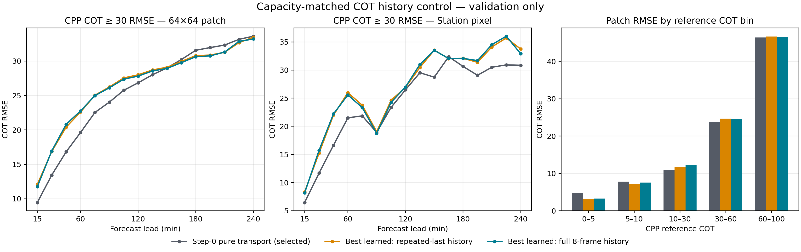

# 四里全历史 COT 单因素容量匹配试验结果（2026-09-28）

## 结论

全历史输入没有让学习残差头稳定优于重复末帧对照，更没有优于零残差的纯输运基线。两臂按预注册的 CPP COT≥30 patch RMSE 选模，最终都选中 step-0 纯输运。因此这轮不放行 GHI-head 训练；当前证据支持停止这条“在输运后学习厚度残差”的分支，不能据此否定 COT 或历史轨迹本身。

## 对照合同

在同一个固定 512 train / 512 validation 四里 bank 上，full-history 使用八张真实历史 COT 图；repeat-last 对照把最近一张 COT 图复制到八个时间槽。两组都保留相同的末两帧差值、冻结 SimVP→R 未来 COT、平移后的历史 COT、局地位移、lead 和同一个 15 通道 Conv3d 头，参数量、零残差初始化、优化器、seed、样本顺序、损失、batch 与更新上限相同。初始化数值见证的最大绝对差两组均为 0。区别因此限于“更早六帧的 COT 是否提供额外信息”。

训练与选模只使用固定验证 bank：seed 42，每组完成 256 次更新；每 16 次更新验证，best learned checkpoint 按 patch 厚云 RMSE 选择，且与 step-0 纯输运共同竞争。batch 512 是本次profile中最大可行批量，A800峰值PyTorch allocated显存39.74 GiB。72个初始化日做配对bootstrap（5000次，seed 20260928）。测试集未读取，GHI头未训练。

## 结果

统一评价掩膜为 CPP 有效像元与输运支持域交集，覆盖 21,153,251 个 patch pixel-leads（约占 CPP 有效 pixel-leads 的86.9%）。站点像元共5,664个有效时效，其中204个 CPP COT≥30。CPP是卫星反演参考产品，并非独立云厚真值；窗口重叠且像元/时效不独立。

| 候选（patch厚云指标选出的验证快照） | Patch全域RMSE | Patch COT≥30 RMSE | Patch厚云漏报率 | Patch晴空误报率 | 站点全域RMSE | 站点COT≥30 RMSE |
|---|---:|---:|---:|---:|---:|---:|
| Step-0纯输运（两组均选中） | 9.520 | **26.504** | 27.47% | 5.81% | 8.738 | **25.163** |
| Repeat-last最佳学习头（update 160） | 9.440 | 27.209 | 28.01% | **3.52%** | 8.192 | 27.606 |
| Full-history最佳学习头（update 96） | 9.603 | 27.143 | **27.10%** | 3.88% | 8.325 | 27.609 |

全历史相对 repeat-last 最佳学习头的厚云 RMSE 差为 patch −0.067，按初始化日配对95%区间[−0.161,+0.029]；站点 +0.003，区间[−0.316,+0.293]。区间都跨0，未见稳定历史轨迹增益。

全历史最佳学习头相对 step-0 输运的 patch 厚云 RMSE差为 +0.638，95%区间[−0.032,+1.336]；站点差 +2.447，区间[+0.573,+3.977]。patch区间跨0，站点区间支持退化。Repeat-last学习头对比输运的patch差为+0.705（区间[+0.054,+1.386]），站点差+2.443（[+0.561,+4.057]）。这些区间用于验证集诊断，checkpoint已按同一验证集选择，属于post-selection描述，不作独立显著性确认。

分COT档结果说明残差头在做厚度/类别权衡，而不是单纯没有更新：patch COT<5误报率从输运的5.81%降至repeat-last的3.52%和full-history的3.88%；但两个学习头的COT≥30 RMSE均升至约27.1（输运26.50），站点厚云RMSE均约27.6（输运25.16）。分时效曲线见[验证图](../results/regional_station_cot_20260927/sili_full_vs_repeat_last_history_20260928_v5/history_control_validation.png)。不同候选在多数lead上的差异较小；+15到+240分钟均未形成全历史一致占优的图景。

## 解释与决策

1. 这轮排除了“之前对照头参数量不同、没有真正重复末帧，因此全历史差异可能来自容量”的主要混杂：本次两臂结构及参数量相同，零残差函数也数值等价。
2. 更早 COT 帧对当前模型的厚云条件误差没有可复核的增量帮助；这与此前线性探针的近零历史增量一致，但仍只约束当前表示和训练合同，不能证明非线性轨迹无信息。
3. 学习残差持续偏向减少低 COT 假云，代价是厚云振幅误差；全历史没有消除这个权衡。即使 patch总体RMSE略降，也不能越过预设厚云选模门槛。
4. 保留纯输运作为当前四里COT验证候选，关闭本分支的追加训练和下游GHI训练。测试集保持封存。
5. 后续若继续，应先审计CPP/AGRI时空对齐与输运标签支持链，或提出一个明确隔离厚云强度/增长消散的单因素目标，再做小验证pilot；不可直接增加模型容量、打开test或把本结果解释为GHI收益。

## 运行与产物来源

- 成功作业：PBS `211099.tc6000`，node22单卡A800；末尾日志包含 `SILI_FULL_VS_REPEAT_LAST_COMPLETE`。
- 固定银行manifest SHA-256：`7a7df500b1ac8e9606c6b0a64c35846907e0e2ac5294d2295076d9c36c41c0e`。
- 最终训练脚本SHA-256：`2ee6c7cf12300f4af345d54e8b0548ef4079c6b4efab3b436493eaa3d4c420f1`。
- 完整训练快照、逐日统计、逐时效验证指标、batch profile与PBS日志归档于 `results/regional_station_cot_20260927/sili_full_vs_repeat_last_history_20260928_v5/`。绘图脚本为 `scripts/plot_sili_full_vs_repeat_last_history_20260928.py`。
- 前四个只到准备/profile或验证聚合、未完成训练的尝试均未作为结果采用；最终版修正了见证设备放置、控制臂名、站点逐样本维和单帧基线的16时效显式扩展。PBS日志和成功快照为最终证据。

## 后续同权重输入替换与统计修正

用户提出新增历史帧为何没有改善后，用同一full-history已训练checkpoint把历史槽替换为末帧重复，发现模型对旧帧有非零但较小的响应：公共域平均输出变化0.326 COT，厚云处0.982 COT；真实旧帧让厚云处预测平均低0.590 COT，全域RMSE小幅改善而厚云RMSE由27.083升至27.143。详见 `docs/SILI_HISTORY_USE_COUNTERFACTUAL_20260928.md`。这说明“增加历史信息”与“增加训练样本”不同，也说明旧帧在当前目标下的修正方向未带来厚云收益。

本次八帧历史被堆成八个输入通道并在16个未来lead重复，Conv3d沿未来lead而非历史帧卷积；较早帧也未逐帧输运到未来站点。因而上述结论限于这种通道堆叠实现，不能称为对完整历史时空轨迹建模的否定。

原始训练JSON中的`simvp`诊断列误复制首个未来时效至全部16帧，该列不参与上述三个主候选的训练、选模或图表；修正后的16时效SimVP→R分数已在同权重诊断侧车重算。原始训练脚本以SHA `2ee6c7cf12300f4af345d54e8b0548ef4079c6b4efab3b436493eaa3d4c420f1`归档在结果目录，训练JSON保持原样以保留来源。

本结果只支持对当前验证集、CPP参考目标及固定合同的诊断结论，不是正式GHI性能结果，也不是独立物理真值评估。
