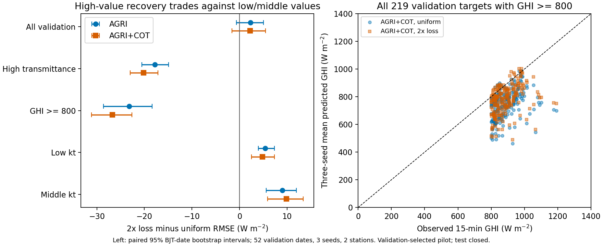
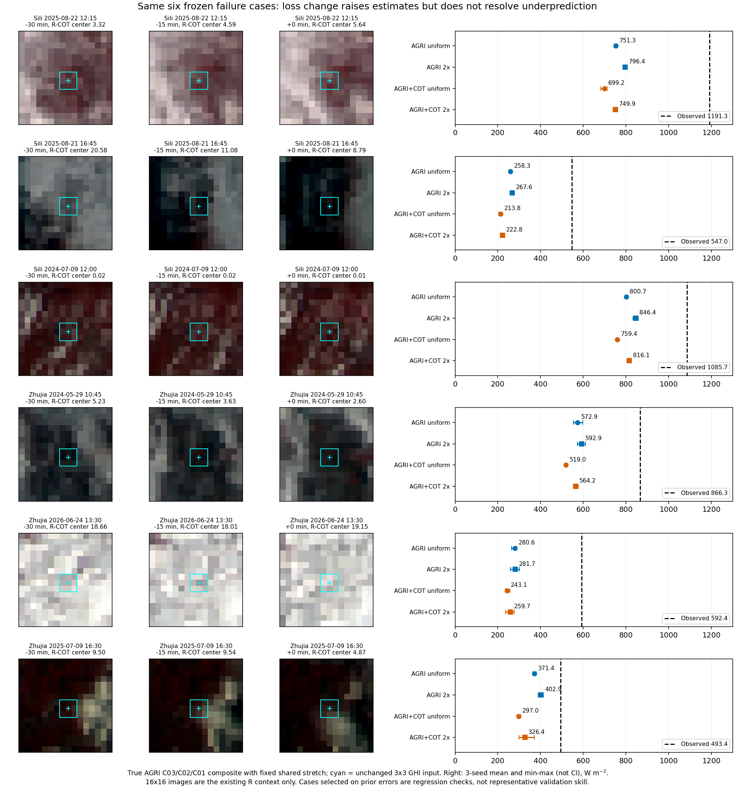

# 高透过情景2倍损失：已执行，未通过整体要求

2026-10-16。**本次完成了单因素训练修正，不是重复诊断：高辐照度低估减轻，但低/中kt情景退化，全验证RMSE上升，因此不采用该候选，不替换原模型。**

## 为什么选这个改动

已有统一输入残差能部分恢复高值；连续COT历史确实进入网络；修正R太阳几何却没有稳定的下游收益。因此本次直接改变GHI训练目标，检验增加高透过情景的误差代价是否能恢复高值，保持表示与模型不变。证据支持进行这一检验，没有预先证明训练目标是唯一根因。

原目标已经是物理GHI MSE，不重做旧kt→GHI损失实验。新目标仅对train中`clear≥100 W/m²且observed interval kt≥0.9`的记录赋2倍权重，其余1倍，再除以该站全train平均权重；上下两个误差方向同等惩罚。训练中可使用监督真值定义损失，推理时没有真值输入、标签门控或上调分支。四里5,482/22,930（23.91%）、竺家4,531/24,736（18.32%）训练记录属于该组；不能据此称其极度稀少或将频率失衡认定为根因。

## 固定对照与复现

原损失/2倍损失 × 无COT/有COT，共4组；两站独立、seed42/43/44，共24次拟合。GHI仍是原3×3、T−30/T−15/T三帧、41,665参数，30epoch、batch1792，训练47,666条/验证4,263条（52个目标BJT日期），同初始参数、顺序、更新数、AdamW与学习率日程。R-COT采用修正几何R的原空间场；同train归一化，缺失/可疑源零值的处理不变。无SimVP/R重训，无新增结构，无全图均值/p90，无test载荷。

本轮各臂均在同一RTX4060 Laptop/PyTorch2.5.1环境从头训练；服务器账户已有3个未结束PBS任务，未qsub、未用登录节点训练。此前node22原损失控制的逐样本预测在本机重跑后最大差：A 0.000488、AC 0.000366 W/m²，源合同没有因换硬件产生实质漂移。公平的损失对比仍用本轮四臂，不把硬件变化当成因素。

选模保持每轮全验证未加权RMSE，未用高值子群或六个旧案例选checkpoint。所有候选完成后执行FP64复算、同目标BJT日期2000次配对bootstrap；第二实现逐行加权复现主值和区间，差<1e−8。区间条件于已查看的验证集及验证选模，不是独立测试证据。

## 配对结果

RMSE单位W/m²，先对每站三seed平均，再两站等权。负Δ有利新损失。高透过组不是绝对高GHI的同义词，故同时列出实测≥800组。

| 共同验证组 | N | AGRI原损失 | AGRI新损失 | Δ | AGRI+COT原损失 | AGRI+COT新损失 | Δ |
|---|---:|---:|---:|---:|---:|---:|---:|
| 全验证 | 4,263 | 108.236 | 110.500 | +2.264 | 107.784 | 110.004 | +2.220 |
| 高透过：clear≥100、kt≥0.9 | 748 | 124.047 | 106.234 | −17.813 | 128.375 | 108.171 | −20.204 |
| 实测GHI≥800 | 219 | 166.056 | 142.832 | −23.224 | 175.070 | 148.322 | −26.748 |
| 高透过且中心R-COT≥3 | 88 | 192.933 | 172.227 | −20.706 | 204.045 | 182.395 | −21.649 |
| 低kt：clear≥100、kt<0.3 | 1,392 | 112.800 | 118.174 | +5.374 | 109.159 | 113.950 | +4.791 |
| 中间kt：clear≥100、0.3≤kt<0.9 | 1,669 | 100.498 | 109.514 | +9.016 | 98.692 | 108.577 | +9.886 |

有COT组的关键日期区间：

- 高透过ΔRMSE **−20.204 [−22.957,−17.173]**，相对下降15.74%；该组bias从−90.593变为−67.680 W/m²，仍明显低估。
- 实测GHI≥800的ΔRMSE **−26.748 [−31.095,−22.616]**，相对下降15.28%；bias从−142.268变为−110.580 W/m²，仍未修好高值峰。
- 全验证ΔRMSE **+2.220 [−1.572,+5.463]**，点估计变差2.06%，区间跨零，不能说整体退化已被统计确认。
- 低ktΔRMSE **+4.791 [+2.499,+7.299]**、中间kt **+9.886 [+5.921,+13.418]**，代价在当前验证分层中方向稳定。

两站全验证均退化：四里有COT 123.775→126.220，竺家91.793→93.789。仅评分排除50条可疑源零值，有COT仍87.955→88.618（Δ+0.663，区间跨零），不能用原有零值疑点解释掉全部代价，也不能把这份敏感性作为主结果。

## 是否真的把低估往上修了

以相同原无COT A定义高透过且低估的1,946个seed—样本记录：新无COT组有93.8%向上、90.5%降低平方误差；新有COT组有80.8%向上、76.9%降低平方误差。此处是针对同一固定A的评分，真值没有进入推理。

但同损失内COT相对AGRI仍没有稳定额外收益：新损失下全验证AC−A为−0.495 W/m²，区间[−2.816,+1.330]；高透过为+1.937，区间跨零；实测GHI≥800为+5.490 [ +1.153,+9.367 ]；高透过有云组为+10.168 [ +0.892,+18.539 ]。新损失改善高值不能归为COT贡献。

整体输出bias也从有COT原损失−2.992变为新损失+8.156 W/m²。它产生了广泛上移，且不同情景幅度不同，不能称模型只加了同一个常数；高值收益与低/中值误报共同表明，这个目标尚未让模型可靠区分需要上调与不该上调的输入条件。不能据此证明现有输入没有可辨识信息，也不能将其全归因于云影、反演误差或云边增强。

## 原失败案例是否修好

同六例、同真实云图和同3×3输入，当前有COT模型的三seed均值如下。案例仅作固定回归检查，不替代全部验证，不参与选模。

| 站点、BJT | 实测 | 原损失AC | 新损失AC |
|---|---:|---:|---:|
| 四里2025-08-22 12:15 | 1191.3 | 699.2 | 749.9 |
| 四里2025-08-21 16:45 | 547.0 | 213.8 | 222.8 |
| 四里2024-07-09 12:00 | 1085.7 | 759.4 | 816.1 |
| 竺家2024-05-29 10:45 | 866.3 | 519.0 | 564.2 |
| 竺家2026-06-24 13:30 | 592.4 | 243.1 | 259.7 |
| 竺家2025-07-09 16:30 | 493.4 | 297.0 | 326.4 |

六例三seed均值都上移，但仍严重低估，并未消除COT组相对同损失无COT组的不足。原254条失败组有COT RMSE155.145→131.779，仅为结果依赖选组的条件表现，不能冒充总体增益。

16×16图像只展示原反演器上下文，青框3×3才是GHI输入。RGB为原C03/C02/C01通道固定共同拉伸、nearest显示；不是自然色或云厚度真值。右图点是三seed均值、短线是min–max而非置信区间。

## 决定

**关闭固定2倍权重候选，不替换现有模型，不继续搜索1.5倍/3倍或重选阈值。** 它通过了高透过RMSE和bias改善项，未通过预定“全验证不升、逐站及低值保护”项。高辐照度低估问题保持未解决；本轮可确认的是优化目标能够改变高值恢复，但这种恢复以低/中值误差为代价，不能作为全情景修复。

这条负结果直接限制下一项改动：仅增加高值损失代价不够；下一候选若要继续，应具体改变根据输入区分辐射情景的能力，并与已完成的统一输入残差及本轮损失对照区分。不能再把“允许双向残差”“加入三帧历史”或“R重训”重新包装为尚未做过的解决方案。本轮不擅自启动第二种结构或再诊断一轮。

## 工程证据

- [预先固定方案](PLAN.md)、[环境和命令](ENVIRONMENT.md)、[损失梯度/架构见证](loss_witness.json)。
- 24次实际拟合约48.0秒，不含数据复制、初始化见证、profile、CPU重载和分析；GPU1张、无PBS。Luna原样执行文档命令并监控到完成；24组CPU重载最大差0.000428 W/m²。
- [逐seed指标](analysis/per_seed_metrics.csv)、[独立评分](analysis/independent_score.json)、[第二实现](analysis/secondary_recompute.json)、[六例预测](analysis/six_failure_cases.csv)、[共同预测数组](analysis/paired_validation_scoring.npz)。所有种子保留，不挑选有利种子。
- `data/`保留逐文件SHA核验的train/val副本；`runs/formal_v1/`保留全部权重/预测/训练曲线，二者不进Git。公开compact训练记录在`evidence/`。
- 原始数据与代码来源、源路径在`source_transfer_receipt.json`、`setup.json`及checkpoint内manifest哈希。服务端独立目录为`/public/home/slfu/ttzhou/swc/irradiance_forecast/SolarCOTIFS_20260907/experiments/high_kt_loss_20261016`，保存本轮代码、分析和完整训练归档。
- 本轮真实T帧实际晚于名义T，属于离线同期15分钟区间反演，**不是SimVP预报链收益**。未读test，未修改论文。
