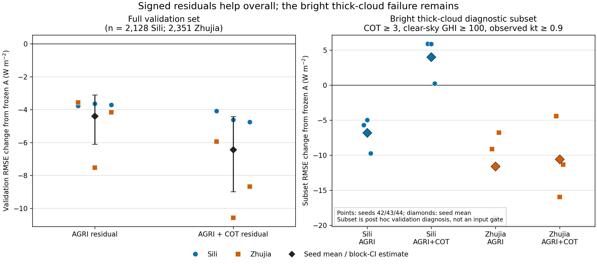

# Signed residual direction experiment — validation results

## Result

The model can learn a correction in either direction because its residual is an
unconstrained signed value trained against the observed GHI error. It is not
given a rule that COT must always decrease GHI. In this validation experiment,
both residual arms improved full-set RMSE over the frozen A model, and the
capacity-matched AGRI+COT arm improved further on average. However, the original
failure mode remains in a small bright, thick-cloud diagnostic subset: the
COT arm still often adjusts downward when the baseline is already too low.

| Arm | Equal-station mean RMSE (W m⁻²) | Change from A (W m⁻²) |
|---|---:|---:|
| Frozen A | 123.979 | 0 |
| A + signed AGRI residual | 119.582 | −4.397 |
| A + signed AGRI+COT residual | 117.538 | −6.441 |

The COT increment over the parameter-matched AGRI residual is −2.044 W m⁻².
Paired BJT-date-block bootstrap intervals are −6.103 to −3.101 for AGRI
residual versus A, −8.990 to −4.418 for AGRI+COT residual versus A, and
−3.687 to −0.533 for AGRI+COT versus AGRI residual. These are validation-only
intervals conditional on checkpoints selected by validation RMSE; they are not
an independent test claim.

| Station | Seed | Frozen A | AGRI residual | AGRI+COT residual | COT increment vs AGRI |
|---|---:|---:|---:|---:|---:|
| Sili | 42 | 135.240 | 131.465 | 131.155 | −0.310 |
| Sili | 43 | 136.197 | 132.555 | 131.578 | −0.977 |
| Sili | 44 | 134.028 | 130.311 | 129.269 | −1.042 |
| Zhujia | 42 | 110.621 | 107.057 | 104.680 | −2.377 |
| Zhujia | 43 | 114.231 | 106.706 | 103.661 | −3.045 |
| Zhujia | 44 | 113.557 | 109.399 | 104.885 | −4.514 |

## The failure mode that remains

The post-hoc diagnostic subset is defined by retrieved center COT ≥ 3,
clear-sky GHI ≥ 100 W m⁻², and observed `kt` ≥ 0.9. It contains 58 unique Sili
rows and 36 unique Zhujia rows. Those labels are used only after prediction;
they are not model inputs or routing gates.

| Station | Arm | Mean RMSE across seeds (W m⁻²) | Mean change from A | Positive correction fraction |
|---|---|---:|---:|---:|
| Sili | AGRI residual | 264.5 | −6.8 | 0.661 |
| Sili | AGRI+COT residual | 275.3 | +4.0 | 0.374 |
| Zhujia | AGRI residual | 242.2 | −11.6 | 0.657 |
| Zhujia | AGRI+COT residual | 243.2 | −10.6 | 0.389 |

Here a positive adjustment is the direction needed when A underpredicts GHI.
The COT branch still chose a positive correction in only about 37–39% of these
rows. It worsened Sili subset RMSE relative to A and the AGRI-only residual;
for Zhujia it improved over A but was slightly worse than the AGRI-only
residual. Thus COT helps the validation average but has not solved the rare
bright-thick-cloud direction error. The subset is small and selected
post hoc, so this is a targeted diagnostic rather than a general performance
claim.

The figure shows seed-level RMSE changes and the date-block interval on the
left. On the right, each point is one seed and each diamond is the three-seed
mean for its station/arm; the subset definition is printed in the panel.

## What this says about correction direction

For each example, the residual head sees AGRI, solar geometry, the frozen A
forecast, clear-sky GHI, and optionally COT. Its output `ΔGHI` is signed, and
the forecast is `max(0, A + ΔGHI)`. The MSE loss compares that forecast with
the observed target, so an underprediction creates a gradient that favors an
upward adjustment for inputs that distinguish that case. This does not mean
the model can identify every physical cloud-shadow situation. If bright,
thick-cloud cases are rare or their input patterns overlap with dimmer cases,
the fitted conditional average can still move them downward.

This distinction is visible here: the residual architecture can improve the
overall point forecast and the extra COT input improves the station-equal
validation score, but the COT-conditioned residual remains poorly directed on
the bright-thick-cloud subset. COT is useful on average in this contract; it is
not sufficient evidence that the model learned the needed cloud-shadow
mapping.

## Contract, verification, and limits

- This is same-time real AGRI→R→GHI retrieval, not SimVP-forecast-AGRI GHI
  forecasting. It tests signed correction learning, not the complete forecast
  chain.
- Existing A checkpoints (seeds 42/43/44) are frozen. Both residual arms have
  exactly 23,173 trainable parameters, use the same station/seed rows, fixed
  epoch permutations, 30 epochs, batch 2000, and validation-RMSE selection.
- Both residual outputs are exactly zero at initialization; the frozen A
  parameters receive no gradients. Reloaded A predictions were independently
  checked against the stored outputs. The maximum observed difference was
  0.462 W m⁻² after disabling cuDNN to avoid a cluster shared-library conflict;
  exact identity is tested against A reloaded in that same runtime.
- The training correction targets use A predictions on A's own training rows.
  This can make correction learning optimistic in-sample. Validation measures
  generalization, but does not remove validation-based checkpoint selection.
- The new monthly test payload remains closed. No test result is reported.
- Independent recomputation and the deterministic 10,000-replicate date-block
  analysis are in `results/signed_residual_direction_analysis_20261014_v1/`.

The next defensible step is to generate out-of-fold A predictions for the
training rows, train these same two residual arms from those cross-fitted
residual targets, and keep the current validation set untouched for selection
and diagnosis. After that, inspect the fixed bright-thick-cloud cases by date
and error direction before proposing a targeted objective or expert branch.

## Execution note

The first attempt stopped on the cluster's incompatible cuDNN library pair.
The second stopped when the initial baseline-reload tolerance was too strict.
Native CUDA convolution passed a one-batch A100 witness; the evidence-based
1.0 W m⁻² reload tolerance and backend difference are documented in the
experiment contract. The full Sili run (PBS `213950.tc6000`) and Zhujia run
(PBS `213952.tc6000`) completed with exit status 0 on one A100 40 GB. Peak
reported device memory was about 1.4 GiB and sampled GPU utilization was
58–87%; this small head saturated useful compute without artificially
allocating the unused memory.

The server experiment directory was
`/public/home/slfu/ttzhou/swc/irradiance_forecast/SolarCOTIFS_20260907/experiments/monthly_R_station16_20261013_v1`.
The train/validation pack was `data/ghi_head_pack_new_r_v1`; result directories
were `results/signed_residual_direction_20261014_v3` (Sili) and
`results/signed_residual_zhujia_20261014_v1` (Zhujia). The pack manifest
SHA-256 is recorded in each run status file. The raw pack remains on the
server and was not copied into Git.

Figure workflow followed the scientific-visualization skill. Reference:
Kassis, T., Agarwal, V., He, Y., Patel, D., & Brueckner, A. M. (2026).
*Scientific Agent Skills: A Library of Procedural Knowledge for Research
Agents*. arXiv:2609.00065. [https://doi.org/10.48550/arXiv.2609.00065](https://doi.org/10.48550/arXiv.2609.00065).
