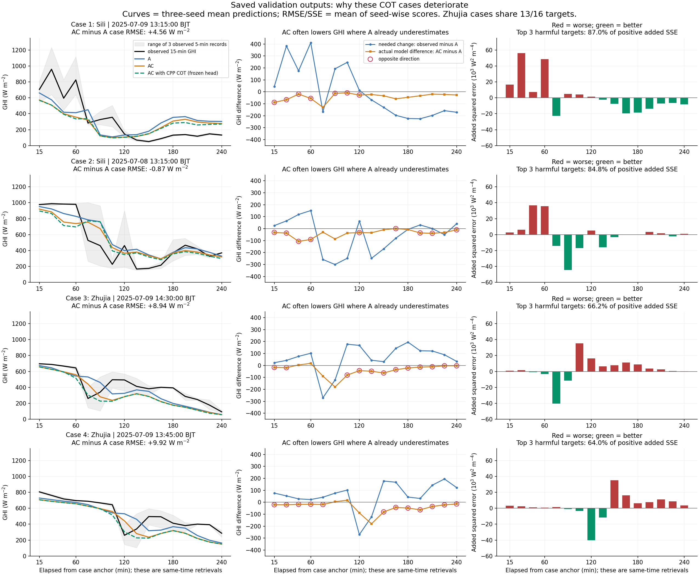
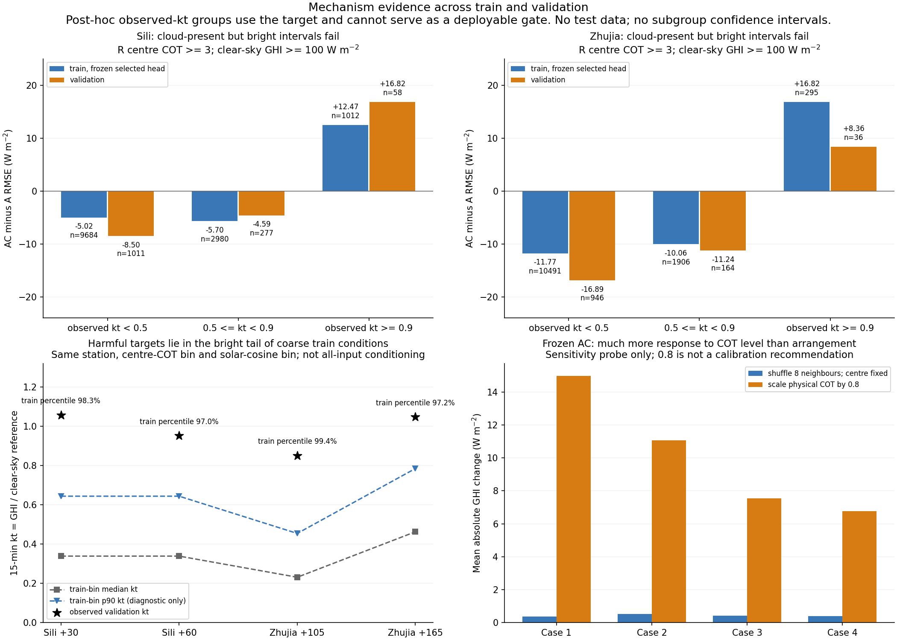

# T16 局部退化：训练分布、冻结头响应与时间/空间来源诊断

日期：2026-10-14。范围：新月度 split 的 train/val、已完成的三 seed A/AC/AP。未读取 test、未启动新训练/PBS/GPU任务。这些是**同期真实 AGRI→R→GHI 反演回放**，不是 SimVP 外推 GHI 评价。

## 1. 当前证据支持的原因

最直接的退化机制是：AC 在这些案例中普遍降低 GHI；当 A 已经低估时，这个变化方向继续扩大误差。更深一层的证据是：当前模型强烈响应 COT 水平，较少响应邻域排列；在训练集和验证集的“局地 COT 较高、实测区间 GHI 仍较高”子群中均失效。因此，这不是只有验证集才出现的偶然日期变化，也不能简单归因于 COT 反演误差。

这支持“当前局地单帧模型学到主要适用于多数遮蔽情景的压低关系，对少见的有云但较亮情景区分不足”。它仍是模型行为与分布证据；不能把云影、云边增强、云高视差或传感器问题当作已查明的物理原因。完整物理归因还需要实际扫描时刻、可追溯的原始云场和地面观测支持。

整体结果也必须保留：完整 4,479 行验证集上，三 seed 站点等权 RMSE A=123.980、AC=120.240 W/m²，AC−A=−3.740，日期块95%CI [−6.180,−1.597]。局部负效应不等于整体失效；反过来，整体改善也不能掩盖这些失败情景。

## 2. 四张案例不是四个独立事件

|案例|站点/锚点 BJT|A RMSE|AC RMSE|AC−A|平均预测变化 AC−A|A / AC 平均偏差|
|---|---|---:|---:|---:|---:|---:|
|1|四里 2025-07-09 13:15|213.851|218.408|+4.557|−41.692|+4.367 / −37.326|
|2|四里 2025-07-08 13:15|151.268|150.397|−0.871|−38.651|+53.961 / +15.310|
|3|竺家 2025-07-09 14:30|129.933|138.871|+8.938|−37.652|−61.205 / −98.857|
|4|竺家 2025-07-09 13:45|126.700|136.617|+9.917|−40.269|−55.843 / −96.112|

单位均为 W/m²，RMSE 为 seed-wise RMSE 的平均，非三 seed 集成预测 RMSE。图中曲线为三 seed 预测均值。两个竺家窗口共享13/16个目标时刻；64个显示行只有51个唯一 `(station,target_time)`，不能把两个窗口当作两个独立重复证据。案例为预先按CPP变化/哈希选择的JJA部分4/16，非误差筛选的全季节样本。

四里案例1的三 seed AC−A 分别为 +0.149、+12.854、+0.668；+4.557 平均值受 seed43 影响较大，应保留训练不稳定性而非概括成稳定的同幅退化。

## 3. 从错误代数定位，退化集中在错误的下调

对每个 seed、每个目标，用保存的预测核验：

`ΔSSE = (AC−y)²−(A−y)² = 2(A−y)(AC−A)+(AC−A)²`。

四例变化方向与所需变化相反的时刻数为7、9、12、12（每例16时刻）。最严重的三个时刻贡献所有正向新增SSE的87.0%、84.8%、66.2%、64.0%。所以病例级约9 W/m² RMSE退化背后存在几十至上百 W/m²的局地错误变化。

竺家案例3 +105 min（与案例4 +150 min相同目标）：

- 实测15 min GHI=495.687；A=317.820；AC=237.393 W/m²。
- 需要相对A增加177.866，实际却减少80.427 W/m²。
- 同一个站点中心像元 R COT=13.001，CPP参考COT=13.270。

这是“局地有云代理与站点较高辐照度同时出现”的真实验证点，不能仅靠把COT从13.001改成13.270来恢复站点预测。AC−A是两个独立拟合模型的差异，包含共同主干的优化变化；不等同于一个显式加性COT模块。冻结AC输入探针用于补足这个归因限制。

## 4. 训练集也失败：单帧关联不能区分亮云情景

对已冻结的18个checkpoint在train上只做CPU前向，并在val上复用保存预测。固定诊断条件为中心 R COT≥3、clear-sky GHI≥100 W/m²。以下按**实测**kt分层，是事后诊断；阈值没有预注册，样本数不等于独立事件数，未计算分层CI，不能作为业务门控或独立天气标签。

|站点|实测kt|train n|train AC−A RMSE|val n|val AC−A RMSE|
|---|---|---:|---:|---:|---:|
|四里|<0.5|9,684|−5.023|1,011|−8.498|
|四里|0.5–0.9|2,980|−5.695|277|−4.590|
|四里|≥0.9|1,012|+12.466|58|+16.822|
|竺家|<0.5|10,491|−11.768|946|−16.891|
|竺家|0.5–0.9|1,906|−10.058|164|−11.244|
|竺家|≥0.9|295|+16.820|36|+8.357|

单位W/m²。训练集是验证选模后冻结checkpoint的训练回放，不是独立泛化结果。该模式在训练样本也存在，所以“验证日期变了”不足以解释；低kt情景的大量收益与高kt情景的局部损失同时存在，解释了总体改善和病例退化并存。

进一步用固定中心COT区间 `[0,.1,3,10,30,101]` 与cosSOZ区间 `[0,.25,.5,.75,1.01]`，在同站train、clear≥100内查询条件分布：

- 四里案例1 +30：观测kt=1.057；对应2,528个train样本中位数0.339，p90=0.644，观测位于98.26百分位。
- 竺家案例3 +105：观测kt=0.850；对应1,876个train样本中位数0.231，p90=0.454，观测位于99.41百分位。
- 竺家 +165：观测kt=1.047；对应857个train样本中位数0.463、p90=0.785，观测位于97.20百分位。

这只是两因素粗分组，不代表对全部13 AGRI通道和空间结构条件化，也不证明样本稀少是唯一原因。这里p90仅是训练目标分布的诊断统计，**没有作为COT输入，也不是整张COT图的p90/平均**。

训练代码最小化的是物理GHI的MSE，并按整体验证RMSE选模，没有针对上述亮尾情景的独立约束。平方误差的最优点预测是给定输入后的条件平均值；若可区分信息不足，更多的低GHI样本会把同类输入的平均预测拉低。这解释了为什么整体选模允许局部牺牲，但当前粗分组不能证明13通道完整输入本身不可区分，仍需表示对照验证。

## 5. 有坐标排列不等于已经利用空间结构

实际头部来源：`head_candidate_v0.py`，AGRI13+cosSOZ/cosRAA→两层1×1卷积；AC的COT→1×1卷积1→4；按固定位置flatten 3×3→MLP64→32→1→Softplus输出kt。不使用GAP；但输入仅为当前3×3，没有历史轨迹，也没有读出前的邻域卷积。它有学习位置关系的能力，不能宣称结构上完全不能学空间；实验显示本轮对外围排列响应很弱。

固定中心，保持八个外围COT值，仅做32次确定性置换，四例三seed均值的平均绝对GHI变化为0.354、0.510、0.419、0.401 W/m²。物理COT×0.8的同头平均绝对响应约为14.98、11.07、7.55、6.77 W/m²。64个显示目标的三seed平均统一log-COT方向导数均为负；结论限定在这些目标及小范围探针。

数值扰动和排列扰动的幅度/物理含义不同，这不是二者信息量的严格比较，也不是无纹理价值的证明。结合T15全验证集的保值排列负结果，足以说明当前增益不能直接写成“已学习到云厚度空间轨迹”。

当前GHI头实际只读站点3×3；R本身从16×16生成COT后裁取中心3×3，可能携带更大感受野和CPP监督信息。现有AP只控制参数容量，不能完整控制这些来源，T18 R-AL对照仍有必要。此前16×16时序方案与这一局地价值试验不是同一个合同，不能混称。

COT来自同一真实AGRI的冻结检索网络，是一个派生表示，并非新增的独立现场测量。它可能提供更大空间上下文和CPP监督学到的表示；但提高对CPP光学厚度的拟合，不能自动补齐站点GHI所需的时间支持和空间对应信息。COT是云的光学厚度，不直接等同于云的几何高度或某个站点区间内的遮蔽状态。

## 6. 哪些备选解释已检验，哪些还没有闭环

### 6.1 单靠更换为CPP参考COT不能修复

保持所有head权重、AGRI、几何、log1p和train归一化不变，只把有效3×3 R COT换成同刻CPP：

|案例|原AC CPU重放RMSE|换CPP后RMSE|同设备变化|
|---|---:|---:|---:|
|1|218.411|216.572|−1.839|
|2|150.396|167.480|+17.084|
|3|138.869|138.674|−0.196|
|4|136.616|135.950|−0.666|

竺家的大部分退化仍在。更大公共验证支持（四里610、竺家674个完整3×3参考）上，CPP替换后的冻结头RMSE为155.836、132.413，原AC为147.506、123.574。头部按R特征训练，换CPP会改变输入分布；**该实验不是重新训练CPP头的上限，不证明CPP错误，也不能否定改进R后重训GHI的价值**。

### 6.2 直接GHI头的太阳几何通路影响不足

在实际grid_static的经纬度和卫星方位上，用pvlib0.9.1 SPA、UTC、pressure=0重算51个唯一目标及3×3像元。中心最大cosSOZ偏差0.01823、天顶角1.16350°、cosRAA偏差0.02498。以新几何替换直接H输入，AC的病例RMSE相对同CPU原输入仅改变−0.204、+0.218、+0.061、−0.065 W/m²，不能解释竺家约9 W/m²退化。

这只检验直接H几何通路；**R仍使用原几何，本次未以新几何重算R**，因此不能全局排除几何对R反演的影响。拟合“等效+5～5.25 min”只是数值等效诊断，不能由此认定标签错移5分钟，也不能直接移动标签。

### 6.3 时间支持存在实质疑点，但没有统一偏移修复证据

64个显示目标的标签都与对应三个5 min记录平均值一致（最大误差<1e−6）。但是单个标称时刻图像不足以完整描述一个15 min区间：四例区间内原生记录的平均极差为153.5、197.9、110.9、106.1 W/m²。

四里案例1 +30的原生记录为1232/640/1002，区间均值958；但竺家案例3 +165的404.93/391.98/405.89几乎稳定，仍出现A257.97→AC222.70、实测400.93。因此区间内快速变化可以解释部分失败，不能解释全部。

辅助缓存记录扫描行中点相对文件标称开始时刻：四里约+184.35 s、竺家约+159.47 s。若源字段定义正确，名义“同刻”图像的实际观测支持会晚于15 min标签结束时刻约3 min；需要在原始NOMObsTime链路上确认并明确回放坐标。已尝试按grid_static真实HDF行列访问51条源HDF元数据，PBS当前路径全部FileNotFound，**缓存不是本次原始HDF重读证据**。原HDF路径、失败和缓存值保存在scan审计中。不能将该缓存偏移自动认定为本次退化主因。

将COT与AGRI相对错移−15 min可把案例1 AC RMSE从218.41降到209.82，却使案例3从138.87升到154.12；+15 min对案例3有利，却使案例1升到234.89。四例每种错移的16个供体均存在且属于val。+15 min是额外未来输入，只作不可部署诊断。没有支持统一错移时间的证据。

### 6.4 没有支持统一移动空间标签的证据

固定AGRI，分别用R/CPP的空间场，测试中心3×3取样在±2像元内25种平移。总体比较要求所有25种窗口都在同一个有效7×7公共区域，四里608、竺家674个目标。

案例上选最优偏移是事后选择，不能直接修改位置。跨日期检查例如(−2,−2)：四里R的RMSE反而+0.931、CPP+2.385；竺家R−2.000、CPP−0.739。四里R仅15/38个日期改善，竺家24/44。最优方向也不一致：四里R(−2,+2)、CPP(0,+1)，竺家R(0,−2)、CPP(+2,−2)。这不支持“所有数据统一错位两像元”。空间位置、云影与检索参考仍需更多来源证据，而非误差最小化后搬动标签。

### 6.5 优化日志未显示训练中断

18个head日志均有完整0–29轮，AC最佳验证epoch为23–28（zero-based）。AC最后十轮的train epoch-RMSE下降约0.36～1.20 W/m²，最后一轮val与best差0.006～0.412。日志不支持“训练没跑完”解释当前退化；但当前调度下接近平台不等于容量/优化已达到全局最优，不能保证加轮次无效。

## 7. 有证据支持的下一步

1. **先闭合真实观测时间与区间支持。** 恢复这些源HDF的可读入口，按真实row_index/col_index核验NOMObsTime，并与源文件名/UTC、aux偏移、CPP时间及标签结束窗口核对。计算clear-sky参考应覆盖相同标签区间。没有来源确认前不改标签、不把SPA等效偏移当作修复。
2. **把“云→站点作用”作为改动对象。** 在同期价值阶段，准备有明确时间支持的历史+当前AGRI/COT局地序列，与当前单帧A/AC/AP做相同样本、预算、损失的配对对照；在预报阶段则必须只用初始化前历史及因果预测场，真实未来不能成为业务输入。先检验轨迹/区间表示是否降低有云且亮的错误压低，同时保持低kt收益，再决定扩大邻域或学习空间权重。
3. **并行保留R-AL来源控制。** 对照同R感受野/CPP监督的潜变量，辨别有效的是物理COT还是检索模型额外上下文；不以AP容量控制替代它。
4. **预先固定副指标和停止条件。** 主比较仍用完整共同验证集的站点等权GHI RMSE；报告低估偏差、参考定义的云边/变化事件和亮尾误差。禁止按实测kt在推理时开关COT；不得凭这些val病例把COT统一乘0.8。改动若仅靠更强下调获得总体收益而放大亮尾，不能宣称改善云场到站点的物理对应。

本次完成的是诊断与可复算证据，不自动放行新模型训练，也不改主方案或test门禁。物理机制未完全闭环，应如实保留这一边界。

## 8. 复现、来源与数值精度

- 主病例评分使用保存的A800预测、FP64复算；最大CPU重载逐点漂移0.607 W/m²。**所有小量输入替换差异使用同CPU replay基线**，避免把跨设备漂移误解为效果。
- bank与R验证侧车绑定同一R checkpoint，log-COT最大差0.003369、物理COT最大差0.231804，保留跨batch重放漂移。主COT输入探针用实际训练bank，空间移位用完整R验证侧车并和同来源中心比较。
- `forensic_audit.json`：全部病例、公共支持、逐日期移位结果、train/val分层、hash和范围限制。
- `per_target_diagnostics.json/.csv`：原始数值表、原生5min记录、误差分解、COT/梯度/扰动、粗条件训练分布与时间供体存在标记。
- `solar_geometry_audit.json/.npz`：SPA核查与51组3×3替换几何；`scan_metadata_audit.json`：原HDF读取失败及缓存时间值。
- `optimization_log_audit.json` 与六个 `metrics_seed*_*.jsonl`：完整训练/验证优化日志，只读复制。
- `figure_audit.json`：两个PNG/PDF、数据和render脚本hash；PNG已实际打开检查。所有代码位于 `experiments/monthly_R_station16_20261013/`。
- 复算：在有torch/numpy的CPU环境运行 `diagnose_t16_deterioration.py`，需原训练pack的train/val数组、18个checkpoint/保存预测、三seed运行metadata、CPP验证侧车、标签表、四例manifest、SPA替换npz与六个日志。大数组/权重不提交git，其hash/来源由已有pack和本诊断审计保留。
- 绘图：普通numpy/matplotlib环境运行 `render_t16_deterioration.py`，只读取上述审计和逐目标JSON。横轴是相对病例锚点的时间，不是模型已经执行了预报的证明。
