# 云光学厚度辅助的卫星辐照度反演及短时预报

## 摘要

云光学厚度（COT）表征云对太阳辐射的衰减，但在多光谱卫星图像已可用时，显式COT对辐照度估计能带来多少额外改善仍不明确。本文构建COT辅助的辐照度估计方法，将FY-4B/AGRI图像反演的局地光学厚度场与光谱、太阳几何信息融合，估计15分钟平均总水平辐照度（GHI）。在湖北三站和湖南两站，分别独立训练模型，并与不含COT的模型比较。在湖北验证样本上，加入COT使GHI均方根误差由74.41降至68.63 W/m²，降低7.76%。卫星参考产品覆盖的厚云子组降幅最大，为35.51%，同时辐照度正偏差减小；薄云和中等厚度条件下的改善则具有更大的不确定性。将辐照度模型用于预测云图后，该方法扩展至15～240分钟预报，加入COT使湖北和湖南区域验证RMSE分别降低4.90%和1.70%。控制输入替换进一步表明，预测COT保留了有用的云演变信息，但GHI预报仍对该表示中的误差敏感。结果表明，显式COT可作为多光谱图像的有效补充，改善辐照度估计与短时预报，其收益随云况和区域而变化。

## 1 引言

云调制到达地面的太阳辐射，其位置和光学厚度变化会引起站点辐照度波动。静止卫星多光谱图像提供对这些变化的高频观测，是卫星估计地表太阳辐照度的重要基础[1]。云光学厚度（COT）描述穿过云柱的消光，其基于太阳反射辐射的反演具有物理基础，但薄水云条件下的反问题可能存在多解性[2]。这些性质使COT成为潜在有用的辐照度表示。

卫星辐照度方法长期以来就显式描述云衰减。早期云指数方法将观测反射率与晴空地表及有云参考联系起来[3]，Heliosat-2进一步将定标卫星观测与大气光学模型结合[4]；这些指数与COT不同。物理方法则将反演云属性用于辐射传输计算或其近似。Takenaka等构建了辐射传输的神经网络近似，用于估计地表辐射[5]；Heliosat-4通过查找表和卫星云属性分别描述晴空辐照度与云消光[6]。这些研究确立了云光学属性在辐射估计中的作用，但并未确定对已经接收多光谱图像的模型，显式COT还能带来多大增量。

数据驱动反演学习光谱、空间和时间信息与地表辐照度的关系。Chen等研究了总辐照度与直接辐照度估计中的光谱选择[7]；STARNet引入FY-4A的邻近时空信息[8]；Schuurman和Meyer则将卫星产品模拟与地面观测微调结合，用于Meteosat辐照度反演[9]。云属性也可单独学习：Xia等针对单层非降水云，利用FY-4B反演夜间COT[10]。在混合辐照度方法中，Liao和Coimbra比较有无SCOPE派生特征的CNN，并将其扩展到短时预报[11]。这些方法促使我们检验在原始图像之外加入云监督表示的作用。本文COT由同源观测得到，引入的是云属性监督信息，并未增加独立测量。

这种表示的作用可能随云况变化。云光学属性与气溶胶影响辐射误差[12]，卫星观测几何以及云与地面云影之间的位移，则使卫星和站点观测的比较更加复杂[13]。近期FY-4B预报研究也采用与天气条件相关的订正，处理卫星到站点的辐照度差异[14]。因此，仅用总体误差不能完整描述模型表现。本文在固定光学厚度范围内比较COT的作用，并分析连续云场与辐照度演变，将总体改善与具体云况和辐照度变化联系起来。

预报进一步引入了未来云场的不确定性。Sirch等外推云光学厚度，用于直接法向辐照度短临预报[15]；Miller等在太阳辐照度预报中结合云平流、云属性和云影几何[16]。学习型方法预测不同的中间变量：IrradianceNet预测卫星反演辐照度场[17]，Chen等采用深度学习模型链开展卫星日内预报[18]，Cloud-FNO则预测云物理属性[19]。这些方法展示了连接云演变与辐射的不同路径，其预报目标和参考数据各不相同。

在本文云图外推链中，反演器和辐照度模型接收预测图像。云位置、边界或生消误差，既可以通过图像输入直接影响GHI，也可以经过反演COT间接传递。卫星短临方法的比较表明，数值精度、空间形态及不同天空条件下的表现，未必由同一模型占优[20]。因此，本文通过配对输入替换及对齐的云场和辐照度轨迹分析云图预测误差的影响，并结合总体误差统计，从互补角度评价预报表现[21]。

本文回答三个问题：（1）在AGRI与太阳几何之外，局地COT能改善多少GHI估计；（2）改善发生在哪些光学厚度条件和云事件中；（3）这种作用在15～240分钟预报中能保留多少，又如何受到云图外推误差限制。湖北开展主要站点比较，湖南独立训练模型提供补充区域证据。本篇重点研究云物理表示的价值及误差传递，更优云图外推模型的开发作为后续研究问题。

**表1：相关工作对照，比较研究设计，不跨数据集排名RMSE。**

| 研究 | 表示与任务 | 对本文问题的启发 |
|---|---|---|
| Chen等[7] | 多光谱选择、GHI/DNI估计 | 光谱表示怎样进入紧凑站点映射 |
| Papachristopoulou等[12] | 云/气溶胶信息与辐射计算、短时预报 | 云况和时效怎样影响辐射误差 |
| Zhang等[19] | Fourier神经算子预测云物理属性 | 演变与空间结构是否保留 |
| 本研究 | 保留AGRI并加入反演COT，配对表示和预报控制 | 显式COT是否在同源图像外增加GHI价值，依赖哪些输入条件 |

## 2 研究区域与数据

### 2.1 区域、卫星观测与云参考产品

主要区域包含湖北牛首、王寨和米庄，湖南四里和竺家构成补充区域。模型和归一化分别在各区域内拟合。由于地面观测原生时间采样不同，各区域结果分别报告。

AGRI输入为C01～C06、C09～C15共13个通道，使用各区域地理定位网格。图像、几何和COT由相同站点索引配准。COT反演器读取16×16裁块，辐照度模型从该裁块中选取以站点为中心的3×3邻域。

云参考为归档FY-4B/AGRI云物理属性（CPP）检索产品，包含无量纲COT和云相，利用经纬坐标配准至区域AGRI网格。COT监督像元要求参考值有限且处于[0,100]，并满足白天及太阳天顶角小于80°；有效零COT保留。湖南还要求AGRI输入有效且云相属于有效的晴空、水云或冰云类别，湖北则独立使用COT有效掩膜，不再将云相有效性与其求交。缺测参考不参与COT监督与参考厚度分层，但CPP是否可用不限制主要GHI比较。CPP是卫星检索参考，并非独立地面真值；历史生产版本的溯源限制在补充材料中说明。

**表2：真实云图GHI估计的有效站点样本。地面观测原生采样为湖北1分钟记录、湖南5分钟区间平均。坐标为纬度、经度，单位为度；日期为北京时间目标日期。数量是15分钟站点记录数，括号内为不同日期数。验证数量沿用选模时采用的观测质量剔除规则。**

| 区域 | 站点（纬度，经度） | 保留目标日期首末 | 训练记录（日期数） | 验证记录（日期数） |
|---|---|---|---:|---:|
| 湖北 | 牛首（32.0800，112.0400） | 2025-08-01—2026-05-26 | 6,776（214） | 663（20） |
| 湖北 | 王寨（32.0400，112.1200） | 2025-08-01—2026-05-26 | 6,660（212） | 607（19） |
| 湖北 | 米庄（32.1200，112.2000） | 2025-08-01—2026-05-26 | 6,599（213） | 635（20） |
| 湖南 | 四里（25.9479，112.3479） | 2024-04-02—2026-06-30 | 22,930（508） | 1,999（43） |
| 湖南 | 竺家（29.5667，112.4500） | 2024-04-02—2026-06-30 | 24,736（564） | 2,227（50） |

保留的GHI样本在湖北包含20,035条训练和1,905条验证记录，湖南包含47,666条训练和4,226条验证记录。取各站日期并集，湖北训练/验证分别有214/20天，湖南为578/51天。验证目标日期首末为湖北2025年8月22日至2026年5月4日、湖南2024年4月19日至2026年6月25日；首末日期不表示连续覆盖。湖南验证集依据既定站点日观测质量规则，剔除四里2024年9月5日的37条记录。该剔除同时用于训练期间选模和最终评价，没有移除训练记录。

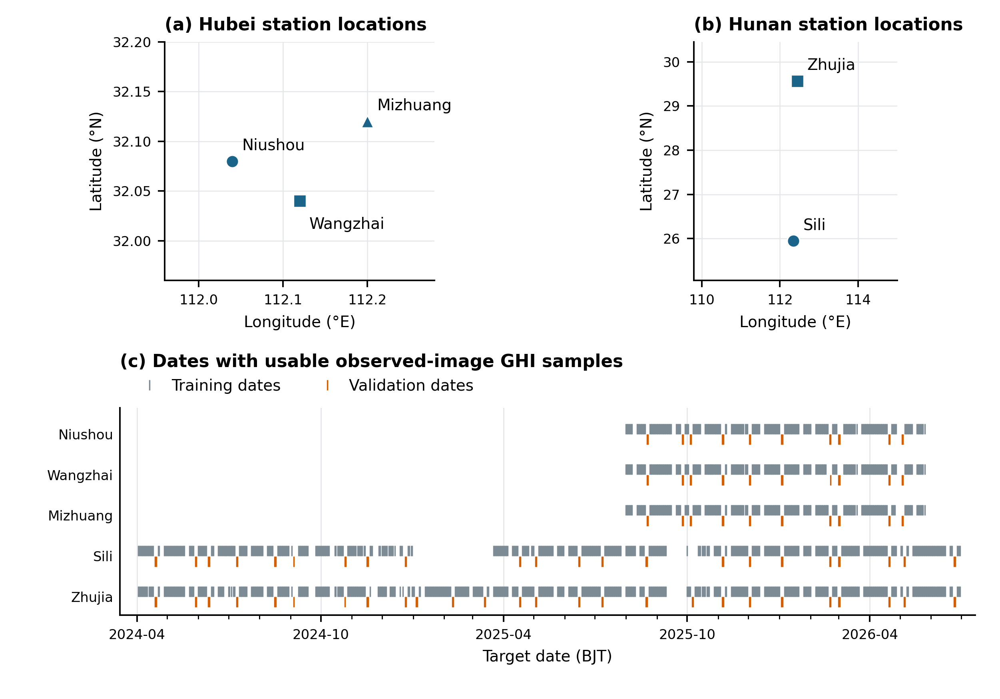

**图1：站点位置与真实图GHI估计的有效日期。(a,b)按不同区域尺度展示配准坐标，不绘制行政边界；(c)每条短线代表应用所述质量排除后至少有一个有效站点样本的日期，灰色和橙色分别为训练和验证。间断表示该有效样本集中没有该日期，不代表零辐照度。图中日期为配对AGRI–GHI样本覆盖，不表示CPP连续可用。**

### 2.2 辐照度标签与太阳几何

令τ为15分钟目标区间结束时刻，站点s的目标为区间平均GHI。湖南5分钟区间末观测聚合为

$$\bar G_{s,\tau}=\frac13\sum_{j=0}^{2}G^{(5)}_{s,\tau-5j\,\mathrm{min}}.\tag{1}$$

湖北在相同右闭区间内按有效一分钟箱构造标签，不完整窗口排除。晴空辐照度使用Ineichen–Perez模型，并在相同区间取平均[22,23]。学习目标与还原为

$$k_{s,\tau}=\frac{\bar G_{s,\tau}}{\bar G^{cs}_{s,\tau}},\qquad\widehat G_{s,\tau}=\widehat k_{s,\tau}\bar G^{cs}_{s,\tau}.\tag{2}$$

晴空指数不截断到1。实测GHI仅作标签，不作为输入。太阳几何依据UTC、经纬度计算并与每幅图像配准。几何输入为太阳天顶角余弦、太阳与卫星相对方位角余弦；反演器另接收白天标记。

### 2.3 时间采样

训练、验证和最终评价按日期块分离，以降低拟合与评价样本的依赖性[24]。两区均在覆盖充分的月份中，分别留出连续两天用于验证、另外连续两天用于测试，并在每个留出块前后保留一天缓冲；合格日不足20天的月份只用于训练。三帧GHI样本或八帧历史、十六帧未来的预测样本，其所有帧必须处于同一分区。归一化只用训练数据拟合。固定影像划分包含湖北34,854/3,171和湖南35,320/3,140个训练/验证序列；这是影像序列数，与表2的站点GHI样本量不同。有无COT的每一对GHI模型使用完全一致的目标标签和晴空辐照度。本文所报结果来自验证集，预留测试分区尚未评价。

## 3 方法

### 3.1 监督COT反演

对于图像A和几何g，反演器输出非负对数COT场：

$$L_\tau=R_\theta(A_\tau,g_\tau),\qquad C_\tau=\exp(L_\tau)-1.\tag{3}$$

采用U-Net编码器—解码器结构[25]，设置两级下采样，湖南特征宽度为32、64、128，湖北为16、32、64，经跳连上采样恢复16×16网格；卷积块使用批归一化与SiLU，输出softplus保证L非负。使用CPP的log(1+COT)监督，采用带有效像元掩膜的Huber损失[26]：

$$\mathcal L_R=\frac{\sum_{i,p}m_{i,p}\rho_{0.1}\!\left(L_{i,p}-\log(1+C^{CPP}_{i,p})\right)}{\sum_{i,p}m_{i,p}}.\tag{4}$$

其中m表示输入与参考均有效的像元，保留有效零COT参考。推理沿用训练归一化，有效性依据可获得的输入和几何判定，不要求未来CPP参考存在。参考质量条件用于监督训练及参考产品评价。反演模型参数在辐照度模型训练及预报期间保持不变。

### 3.2 利用局地COT场估计辐照度

以P_s选取站点中心3×3场，AGRI和对数COT按训练统计标准化：

$$X_{s,\tau,c}=\frac{\mathcal P_s A_{\tau,c}-\mu_c}{\sigma_c},\qquad Z_{s,\tau}=\frac{\mathcal P_s L_\tau-\mu_L}{\sigma_L}.\tag{5}$$

模型接收按原空间位置排列的九个COT值，保留局地变化及不同样本之间的数值差异。两种辐照度模型为

$$\widehat k^A_{s,\tau}=H_A(X_{s,\tau-30:\tau},g_{s,\tau-30:\tau}),\qquad\widehat k^{AC}_{s,\tau}=H_{AC}(X_{s,\tau-30:\tau},g_{s,\tau-30:\tau},Z_{s,\tau-30:\tau}).\tag{6}$$

主估计器使用目标前30分钟、前15分钟及目标时刻的有序三帧。每帧的13个AGRI、2个几何通道与标准化对数COT在同一站点中心3×3网格配准；额外中性槽使实际张量为[3,17,3,3]。时间卷积以3×3×3核将17通道映射至32通道，随后3×3空间卷积保留32通道，有序展平后经288→64→1读出。中间采用SiLU，最终为softplus。两组均有42,529个可训练参数，初始权重相同；基线仅将标准化COT槽置零。帧次序与局地位置被保留，但并未强加云运动轨迹。原单帧设计见补充材料S4。

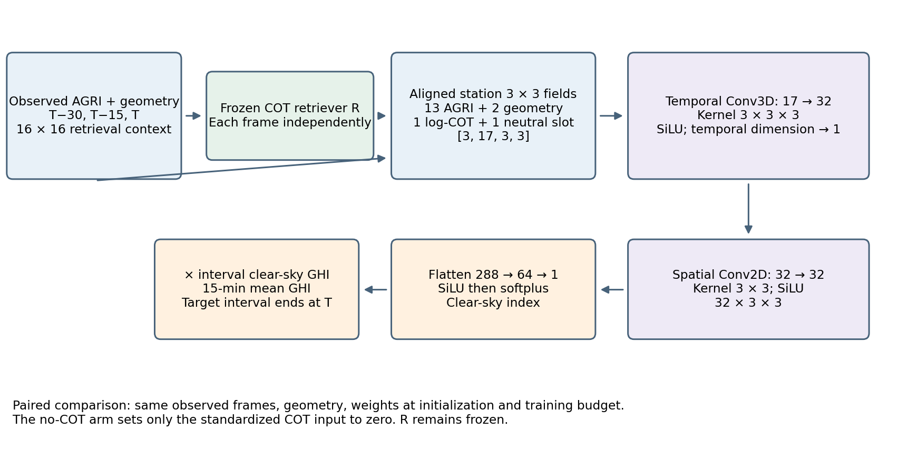

**图2：真实三帧COT辅助GHI估计。冻结反演器分别处理目标时刻及前15、30分钟的观测AGRI，对齐的站点场经实际时空卷积融合。配对模型的可训练容量相同，无COT模型将标准化COT槽置零；额外中性槽在两组均不活动。**

模型优化缩放后的物理GHI均方误差：

$$\mathcal L_H=\frac1N\sum_i\left[\frac{\widehat k_i\bar G^{cs}_i-\bar G_i}{1000\ \mathrm{W\,m^{-2}}}\right]^2.\tag{7}$$

配对训练保持样本、随机种子、样本顺序、优化预算和选模规则一致。最终结构与训练设置见表3。

**表3：主要三帧比较中各模型的区域训练设置。训练和验证数量按各组件自身的合格样本统计；两区模型独立训练。同一地区有无COT的配对模型使用相同设置。**

| 设置 | 湖北 | 湖南 |
|---|---|---|
| **COT反演器：16×16；13个AGRI及3个几何/白天通道** | | |
| U-Net特征宽度 | 16、32、64 | 32、64、128 |
| 监督训练/验证裁块 | 2,738 / 264 | 15,414 / 1,398 |
| 训练/验证有效像元 | 699,023 / 67,187 | 3,886,399 / 352,441 |
| Batch；最大轮数 | 128；50 | 1,284；50 |
| 输入标准化 | 全部训练输入像元，16通道 | 有效训练参考像元；前15通道标准化；白天通道保留二值 |
| **GHI估计器：三帧3×3输入；42,529参数** | | |
| Batch；轮数 | 512；30 | 1,792；30 |
| 标准化 | 各站独立训练统计 | 两站共享训练统计 |
| 随机种子 | 42、43、44 | 42、43、44 |
| **DyDiff云图预测器：256×256；8帧历史预测16帧未来** | | |
| 训练/验证序列 | 34,854 / 3,171 | 35,320 / 3,140 |
| 全局batch；轮数 | 150；150 | 80；150 |
| 每轮更新数 | 233 | 442 |
| 采样 | 25步，单个预测成员 | 25步，单个预测成员 |

COT反演器采用AdamW，学习率10⁻³、权重衰减10⁻⁴、梯度范数裁剪5，最多训练50轮。若验证集有效像元的log-COT Huber损失连续8轮未改善则停止，保留该损失最小的权重。GHI估计器采用AdamW训练30轮，学习率10⁻³、权重衰减10⁻⁴，余弦衰减到10⁻⁵，梯度范数裁剪5；每站每个随机种子按验证GHI RMSE最小选模。AGRI和log-COT标准化固定采用训练数据统计，两个太阳几何输入保留原物理值。每组COT配对比较具有相同初始参数、样本顺序、优化器设置和更新数。预报GHI评价期间，反演器与云图预测器参数均保持冻结。

### 3.3 短时预报

以最后一张历史图像时刻t为初始化，固定外推模型产生

$$\widehat A_{t+k\Delta}=S_\psi(A_{t-7\Delta:t},g)_k,\qquad\widehat C_{t+k\Delta}=\exp R_\theta(\widehat A_{t+k\Delta},g_{t+k\Delta})-1.\tag{8}$$

k=1,…,16，Δ=15分钟。SimVP作为固定基线[27,28]。区域预报比较采用分别在湖北和湖南独立训练的扩散底图模型DyDiff，各训练150轮，并按验证云图预报RMSE选择指数移动平均权重；GHI评价以25步采样生成一个预报成员。两种底图使用相同下游对照。未来太阳几何可确定性计算；未来真实图像与CPP不进入预报输入。

两区DyDiff预测器采用相同因子分解Transformer结构：patch大小8、宽度384、12层、6个注意力头、MLP扩展比4，共65,794,266个可训练参数。两区独立训练150轮，使用1,000步mixed-velocity扩散目标，AdamW初始学习率10⁻⁴、权重衰减10⁻⁴、2轮warm-up、最低学习率10⁻⁶，梯度范数裁剪1。指数移动平均权重随更新次数预热，最大衰减率为0.999。按固定随机种子、单个预测成员在完整验证集上的归一化云图预报RMSE选模；GHI评价使用25步、单成员采样。云图归一化分别用各区训练分区拟合。

将基于观测云图训练的两个辐照度模型用于预测云图，并保持参数不变，以检验加入COT的作用能否延续到预报。三帧配置的+15分钟包含2张已知历史帧，+30分钟包含1张，因此另报告≥45分钟、全部由预测图构成的输入结果。

## 4 实验设计

### 4.1 COT对辐照度估计的贡献评价

每次比较使用相同站点、初始化时间（如适用）、目标时间、GHI标签及有效白天掩膜。先逐站逐种子计算，再在区域内等权平均。报告物理RMSE、MAE、bias及相对RMSE降幅：

$$\eta=100\frac{\mathrm{RMSE}_A-\mathrm{RMSE}_{AC}}{\mathrm{RMSE}_A}.\tag{9}$$

区间采用5,000次北京时间目标日期块配对自助重采样估计，重叠预报记录保留在相应日期块内。这遵循对整组数据重采样、避免将相关记录视为独立观测的原则[29]。最终表格标明评价划分与日期数。采用辐照度模型容量匹配的额外图像特征，以及固定COT反演模型提取的特征，区分模型容量与云属性监督的作用。

### 4.2 云况与连续事件

按站点中心CPP参考COT固定分为近零、薄、中等、厚四档：[0,0.1)、[0.1,5)、[5,30)、[30,100]。各档内所有模型采用同一组CPP参考有效样本，并报告样本数和日期数；总体GHI评价也包含无CPP观测的样本。结合太阳几何与区域分层，检查厚度条件差异是否与其他条件相关。

连续事件组合真实AGRI合成图、反演与参考COT及区间平均GHI。按固定研究顺序的首站牛首筛选验证日期：北京时间10:30–14:30的17个15分钟目标中至少12个有效，站点像元反演COT峰值至少30、极差至少5。随后分别在RMSE改善与未改善两组中取日历最早的合格日期。这种条件选例展示不同方向的响应，不挑选最大变化，也不估计此类事件的频率。反演COT筛选与基于CPP的厚度分层分开定义。

### 4.3 云图预测误差对COT和GHI的影响

保持反演模型与含COT的辐照度模型不变，在相同样本上评价各输入组合。A^o与A^f分别为真实和预测云图；C^o=R_C(A^o,g)、C^f=R_C(A^f,g)为同一反演器产生的物理COT。比较(A^o,C^o)、(A^f,C^o)、(A^o,C^f)、(A^f,C^f)四种组合，分别检验图像与COT输入路径的敏感性。前三种包含未来观测，只用于离线机制分析。

所有比较采用相同站点、起报时刻、目标区间、观测值、有效样本及样本权重。各输入组合采用相同预处理，包括对数COT标准化。三帧配置中已知历史位置保持相同，只替换未来位置。以E_ab表示GHI均方误差，0代表真实图派生输入，1代表预测图派生输入，则

$$E_{11}-E_{00}=\underbrace{(E_{10}-E_{00})}_{D_A}+\underbrace{(E_{01}-E_{00})}_{D_C}+\underbrace{(E_{11}-E_{10}-E_{01}+E_{00})}_{I}.\tag{10}$$

交互项I允许两种输入误差同时作用时不同于分别替换之和。该式是预测误差敏感性的精确分解，不是彼此独立的物理原因分解。各项均在相同样本上以MSE计算。结合COT轨迹误差、云边界位移及站点辐照度变化时刻，解释输入替换差异。

为判断云图预测误差是否削弱COT带来的改善，在相同样本上另将无COT辐照度模型分别用于观测及预测图像，记MSE为B_o与B_f。COT优势为V_o=B_o−E_00、V_f=B_f−E_11，则

$$V_o-V_f=(E_{11}-E_{00})-(B_f-B_o).\tag{11}$$

正值表示用预测云图替代观测云图后，含COT模型的MSE优势减小；负值表示该优势增大。先判断变化方向，再解释预报增益是否减弱。

## 5 结果

### 5.1 反演COT的评价

湖北反演器在264帧、16个验证目标日期的67,187个16×16有效CPP参考像元上，COT RMSE为10.829、MAE为6.054、偏差为+1.185（图3）。这些无量纲指标衡量与CPP检索参考的一致性，并非独立云真值。GHI评价包含所有有效站点标签及无CPP日期，因此参考检索与站点GHI的样本数不同。

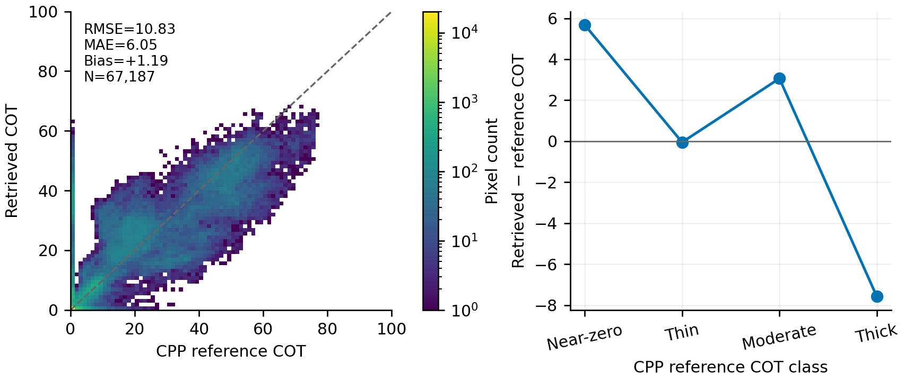

**图3：湖北修正几何COT反演：相对CPP的有效像元密度（左）和参考厚度分层平均偏差（右）。共67,187个有效像元、264帧、16个目标日期；CPP为检索参考，反演器与GHI的COT输入来源相同且固定。**

### 5.2 COT对辐照度反演的影响

湖北真实三帧输入加入COT后，站点与种子等权GHI RMSE由74.406降至68.629 W/m²，降低7.76%（图4）。配对差为-5.776 W/m²，95%目标日期块区间为[-9.650,-2.313]。按连续两日块重采样的敏感性区间为[−10.419,−1.698] W/m²。9个站点—随机种子配对均改善。评价覆盖20个验证日期的1,905条共同站点—时次记录，不输入预测云图。

牛首由69.968降至64.451 W/m²（7.88%），王寨由67.452降至59.215 W/m²（12.21%），米庄由85.797降至82.222 W/m²（4.17%）。米庄日期块区间包含零，因此各站改善的确定性并不相同。每个配对的GHI可训练容量、初始权重、样本顺序、优化器和更新数相同，增加GHI可训练容量本身不足以解释配对差异，但该比较没有将COT与所有其他云监督表示区分开。

湖北三帧训练共20,035条记录；目标标签来自固定候选池，要求三张真实图均可用且属于同一划分。作为湖南补充，固定三帧模型在63,480条预报关联验证记录上使用真实图时，无COT和有COT RMSE为90.318与89.155 W/m²（降低1.29%），配对区间[−3.345,0.958] W/m²包含零。这些重叠记录沿用预报比较的权重，并非63,480个独立站点观测。原单帧表示对照仍保留在补充材料S4，其增益不能当作仅改变太阳几何的消融。

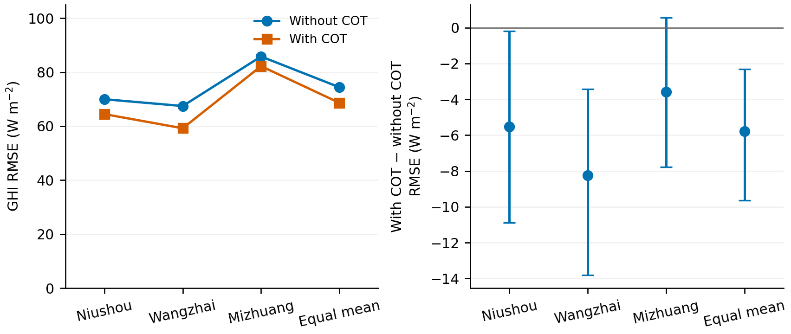

**图4：湖北真实三帧同期GHI估计。左：逐站和等权平均RMSE，先分别计算各随机种子。右：加COT减基线的RMSE差及5,000次目标日期块重采样95%区间；负值有利COT。牛首、王寨、米庄分别663、607、635条验证站点—时次记录。**

### 5.3 光学厚度及云况依赖

湖北参考覆盖子组中，近零、薄云、中等厚度和厚云的RMSE降幅分别为4.20%、6.09%、6.87%、35.51%（图5），各含226、61、185、140条站点—时次记录，覆盖9、4、6、6个目标日期。厚云RMSE由51.521降至33.224 W/m²，降幅95%区间[29.92,44.43]%；平均偏差由+22.408降至+0.635 W/m²，与纠正强光学衰减条件下过高辐照度相符。

薄云与中等厚度降幅区间包含零。近零RMSE降低，但正偏差由+2.921增至+9.830 W/m²；中等厚度偏差由−8.975变为−19.541 W/m²。因此，误差幅度改善并不意味着所有云况下的有符号偏差均改善。612条参考覆盖记录只是1,905条总体GHI记录的子集，无CPP不被解释为晴空。有限日期覆盖限制了厚云大幅改善的可推广性。

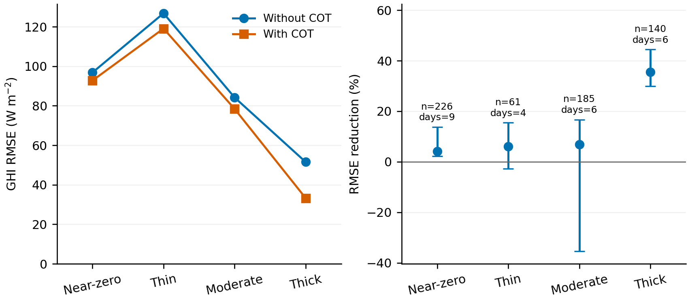

**图5：有效站点中心CPP参考COT分层的湖北GHI误差（左）和配对相对降幅（右）。区间采用5,000次配对目标日期重采样，保持固定站点—种子组；标注为共同站点—时次和目标日期数，无CPP记录仍参与总体GHI评价。**

### 5.4 云事件与辐照度响应

牛首两例表明，COT可以向两个方向改变辐照度响应，并非施加统一衰减（图6）。2025年9月26日，站点像元反演COT为33.5–48.2，实测GHI为50.4–107.1 W/m²。加入COT上调了上午较晚时段的低估值，并降低午后较早时段的高估。15个共同区间的三种子RMSE均值从27.8降至19.3 W/m²。虽然反演COT通常低于可用CPP参考，该表示在此例中仍改善了GHI。

9月27日，反演COT为18.4–31.7，通常高于CPP参考。14:00的实测区间平均GHI升至484.2 W/m²，两种模型的估计均明显偏低。含COT模型给出更低的预测，使16个共同区间的RMSE从92.7升至100.9 W/m²。云场、站点COT与GHI并排展示了局地厚度表示可以改善低辐照过程，但不保证捕捉快速辐照度变化。这两个相邻日期并非独立重复，也不能分离反演误差与空间、时间代表性问题。

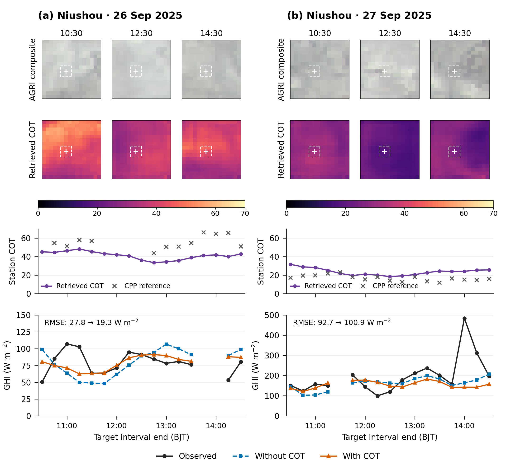

**图6：当前三帧模型在牛首(a)2025年9月26日与(b)9月27日的真实图GHI估计。每列依次展示北京时间10:30、12:30、14:30的真实AGRI合成图和反演COT，以及站点COT和GHI轨迹；每幅快照是对应三帧输入的末帧。合成图采用C03/C02/C01，将反射率统一截断至[0,1]后作平方根显示变换，保留原生16×16像元。十字与虚线框标记站点及3×3输入；COT场和曲线使用共同尺度，GHI纵轴分别为0–150和0–500 W/m²。稀疏CPP参考用不连线的叉号显示。GHI观测为以目标时刻结束的15分钟均值，模型曲线为三种子预测均值，RMSE则逐种子计算后平均；缺测目标保留断线。事件按4.2节选择，展示不同方向的案例而非发生频率。**

### 5.5 COT对预报的影响及云图预测误差传递

在两个独立训练的区域，将真实图训练的辐照度模型直接用于DyDiff预测云图、保持参数不变时，加入预测COT均降低总体GHI预报误差（表4）。湖北站点与种子等权RMSE由101.018降至96.071 W/m²（4.90%）；配对差为−4.947 W/m²，95%目标日期块区间为[−9.983,−0.154]。评价使用外推模型与辐照度模型共同验证日期内、具有有效GHI标签的全部882个预报窗口，共24,451条站点—初始化—目标记录，覆盖17个目标日期，对应1,566个不同站点—目标时次观测。未按天气、CPP可用性或预报误差筛选样本。九个站点—随机种子配对均改善，逐站降幅为4.69%～5.28%，但各站日期块区间均包含零。

湖南在51个目标日期的66,086条记录上，RMSE由122.588降至120.502 W/m²（1.70%），配对差区间为[−3.527,−0.598] W/m²。四里改善2.47%，竺家改善0.76%；竺家单站区间包含零。因此，两区域比较均显示加入COT表示后的总体预报改善，但幅度和不确定性随站点而变化。区域观测时期与样本不同，不能依据绝对RMSE对区域模型质量排名。

**表4：DyDiff云图驱动的+15～+240分钟GHI预报，有无预测COT的配对比较。两种输入均含太阳几何。辐照度模型使用真实三帧序列训练，预报时固定参数。RMSE单位为W/m²，先逐种子计算后平均，区域平均对站点等权。湖北为17个验证目标日期的24,451条记录，湖南为51个日期的66,086条记录。**

| 区域 | 站点 | 无COT | 加预测COT | 降幅（%） |
|---|---|---:|---:|---:|
| 湖北 | 牛首 | 93.890 | 89.431 | 4.75 |
| | 王寨 | 96.595 | 91.490 | 5.28 |
| | 米庄 | 112.569 | 107.292 | 4.69 |
| | 站点等权平均 | **101.018** | **96.071** | **4.90** |
| 湖南 | 四里 | 134.723 | 131.395 | 2.47 |
| | 竺家 | 110.453 | 109.609 | 0.76 |
| | 站点等权平均 | **122.588** | **120.502** | **1.70** |

在+45～+240分钟，三张输入全部为预测图。湖北21,324条记录的RMSE由104.197降至99.273 W/m²（4.73%），配对区间[−10.124,0.093] W/m²略跨零；湖南57,907条记录的RMSE由126.172降至124.012 W/m²（1.71%），区间为[−3.632,−0.638] W/m²。因此，点估计改善并不限于包含真实历史帧的前两个时效，但湖北全预测输入子集的不确定性更大。

两区域16个时效的点估计均显示加入COT后误差降低（图7）。湖北在+60和+240分钟的相对RMSE降幅分别为6.07%和2.06%，湖南对应为2.09%和1.19%。部分时效的日期块区间包含零，湖北长时效尤其如此；总体改善不等于每个时效的收益均能单独与零区分。

为比较底图模型并诊断输入误差，以下湖南分析保留原来51个目标日期的63,480条共同记录。在这一样本范围上，DyDiff加入COT后的RMSE由124.958降至122.788 W/m²（1.74%），配对差区间为[−3.685,−0.735] W/m²。相同样本及辐照度模型使用SimVP云图时，RMSE为127.421和125.340 W/m²（降低1.63%）。两种底图的分时效对照保留于补充图S9。尽管DyDiff点估计误差较低，两种辐照度模型下DyDiff与SimVP差异的配对区间均包含零，因此不能确定哪一种底图模型更优。

固定COT替换表明，预测COT的误差仍限制含COT预报的精度。保持DyDiff AGRI输入和含COT辐照度模型不变，将未来位置的预测COT替换为真实未来云图反演的COT，RMSE由122.788降至108.941 W/m²，配对差为−13.847 W/m²，95%区间为[−17.582,−10.636]。反之，以最后观测COT持平替代未来COT，RMSE升至129.516 W/m²，配对增加6.728 W/m²，区间为[3.587,10.035]。前者含未来观测，仅为离线诊断，不是可实现的预报成绩。两组对照说明，预测COT保留了有用的演变信息，同时仍有较大误差。

【待填：完成对齐COT轨迹及四种输入组合后，再按式(10)量化图像路径、COT路径及交互作用。】

【待填：利用对齐云场与GHI轨迹，识别云团位移、厚度演变减弱或生消延迟对应的误差模式；写出证据所支持的底图外推对预报增益的限制。】

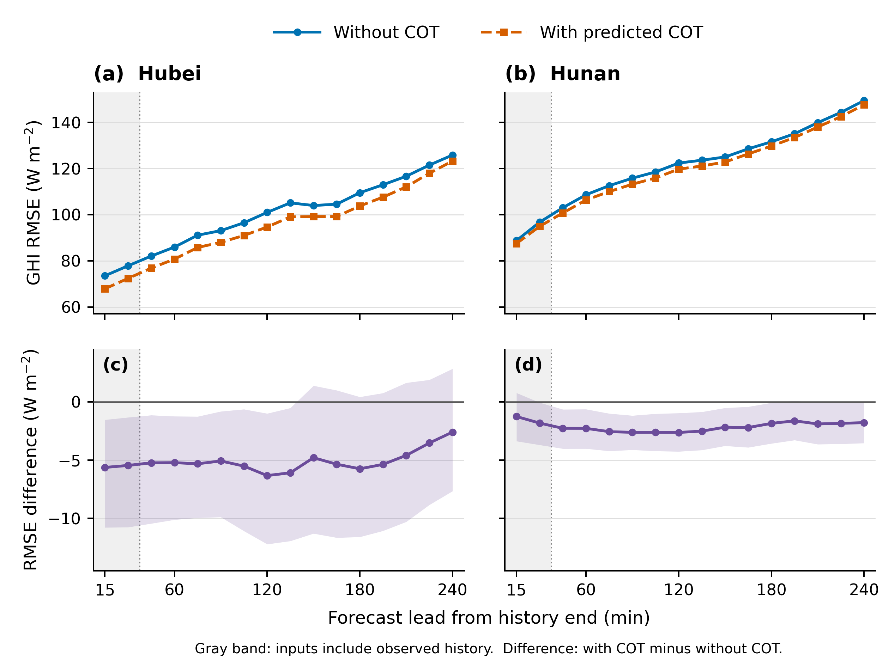

**图7：两区域独立训练的DyDiff与真实图训练的固定辐照度模型产生的逐时效GHI预报误差。(a,b)为不加COT与加入预测COT的RMSE；(c,d)为配对差值（加COT减不加COT），阴影表示5,000次目标日期块重采样得到的逐时效95%区间。先逐站逐种子计算RMSE，再等权平均。湖北为17个日期的24,451条记录，湖南为51个日期的66,086条记录，各时效记录数不同。灰色背景标示仍含已知历史图的前两个时效；+45分钟起三帧均为预测图。两组均包含太阳几何。**

## 6 讨论

### 6.1 COT在辐照度估计中的作用

COT描述云的光学衰减特征，为辐照度模型提供具有明确物理意义的输入。通过云产品训练反演模型，可能帮助辐照度模型利用光谱输入中隐含的云信息。与额外图像特征及反演模型特征的比较，用于评价模型容量增加和云属性监督分别与改善有多大关系。补充材料S4的原几何对照提示云产品监督可能有用，并促使我们评价厚度依赖偏差；其绝对增益不能确定另一太阳几何模型下的对应作用。湖北三帧结果在匹配GHI容量条件下显示COT相关改善；厚云的较大修正伴随正偏差降低。湖南较小的点降幅未能与零区分，因此云监督表示在部分已评价条件下有用，并非跨区域、跨云况均匀受益。

厚度依赖的收益应同时从辐射衰减和辐照度变化理解。基于辐射传输的估计将光学属性误差与地表通量联系起来，而未解析的碎云使其与点观测的一致性更加复杂[5]。云边界、散射辐射及15分钟内的变化也会影响站点GHI映射。云影位移和观测视差还可能改变与站点相关的云像元[16,13]。连续事件展示了加入该表示后的不同辐照度响应，但未分离上述物理过程。

### 6.2 底图外推对预报增益的限制

区域预报结果将COT的作用从真实图辐照度反演延伸至预测图输入：不针对预报微调辐照度模型，湖北和湖南总体RMSE分别降低4.90%和1.70%。这是区域内验证证据，不表示所有站点或云况均匀受益。湖北预报降幅在数值上小于真实图输入的7.76%，但两者样本及时间加权方式不同，仅凭该差异不能量化底图外推对COT收益的影响。

云图预测误差既可以通过光谱和空间输入直接影响GHI，也可以通过这些图像反演出的COT间接影响GHI。云位置误差可能改变云衰减的空间位置和到站时刻；空间平滑可能削弱COT的局地对比；云团增长与消散误差则可能压低或延迟光学厚度变化。已有短临研究区分空间形态与数值误差，并指出表示云演变的困难[18,20]。若预测云图条件下加入COT的改善幅度较小，这些过程可为该变化提供可能解释。

输入替换区分了两个问题：COT相对图像基线是否有用，以及含COT模型在更准确COT输入下能达到怎样的精度。相同湖南记录、相同三帧模型下，真实云图输入的无COT和有COT误差为90.318和89.155 W/m²，降低1.29%，其配对区间[−3.345,0.958] W/m²包含零。该点降幅小于DyDiff输入下的1.74%，因此这些比较未表明外推削弱了COT的相对收益。不过，以真实图派生COT替换预测图派生COT后误差明显降低，说明模型对该输入路径中的误差敏感。这一替换没有进一步分离云图预测误差、反演器在预测图上的行为及辐照度模型对替换输入的响应。单帧与三帧的降幅也涉及不同样本和表示，不能作为误差预算。

因此，改进云位置、边界及光学厚度演变的预测，是值得进一步研究的方向。后续可保持反演与辐照度模型不变，检验更准确的云图预测能否进一步降低GHI预报误差。

### 6.3 适用范围与局限

结果的适用范围取决于区域采样、参考产品不确定性及参与评价的独立天气过程数量。CPP指标衡量与检索参考的一致性，GHI精度以站点观测评价。地面参考质量同样重要：近期FY-4B验证研究表明，辐射仪质量会实质影响卫星辐照度产品的评价[30]。即使总体COT增益为正，表示对照及失败事件仍是解释的一部分。【待填：集中写最终评价范围及最主要剩余限制，不在结果中反复插入运行状态。】

## 7 结论

本文评价显式COT作为卫星GHI局地表示的作用，并追踪其在短时预报中的效果。湖北真实三帧GHI RMSE降低7.76%，三站点估计均改善。参考覆盖厚云子组降低35.51%，正偏差明显减小；薄云与中等厚度区间包含零。湖南真实图补充比较的点降幅为1.29%，区间跨零。采用区域独立训练的DyDiff外推模型，并固定真实图训练的三帧辐照度模型，15～240分钟验证RMSE在湖北和湖南分别降低4.90%和1.70%。在三张输入全部为预测图的+45～+240分钟，点降幅分别为4.73%和1.71%，其中湖北子集区间包含零。这些结果将真实图输入下的证据延伸至两区域的总体预报收益。固定模型COT替换既显示预测演变信息的作用，也显示对COT输入误差的敏感性；尚不能确定唯一物理原因，也未证明云图外推削弱了COT的相对收益。这些证据为后续改善与辐照度有关的云场演变预报提供依据。

## 参考文献

1. Guanghui Huang, Zhanqing Li, Xin Li, et al. Estimating surface solar irradiance from satellites: Past, present, and future perspectives. *Remote Sensing of Environment*, 233:111371, 2019. [DOI/原始出处](https://doi.org/10.1016/j.rse.2019.111371).
2. Teruyuki Nakajima and Michael D. King. Determination of the Optical Thickness and Effective Particle Radius of Clouds from Reflected Solar Radiation Measurements. Part I: Theory. *Journal of the Atmospheric Sciences*, 47(15):1878–1893, 1990. [DOI/原始出处](https://doi.org/10.1175/1520-0469(1990)047<1878:DOTOTA>2.0.CO;2).
3. D. Cano, J. M. Monget, M. Albuisson, et al. A method for the determination of the global solar radiation from meteorological satellite data. *Solar Energy*, 37(1):31–39, 1986. [DOI/原始出处](https://doi.org/10.1016/0038-092X(86)90104-0).
4. C. Rigollier, M. Lefèvre and L. Wald. The method Heliosat-2 for deriving shortwave solar radiation from satellite images. *Solar Energy*, 77(2):159–169, 2004. [DOI/原始出处](https://doi.org/10.1016/j.solener.2004.04.017).
5. H. Takenaka, T. Y. Nakajima, A. Higurashi, et al. Estimation of solar radiation using a neural network based on radiative transfer. *Journal of Geophysical Research: Atmospheres*, 116(D8):D08215, 2011. [DOI/原始出处](https://doi.org/10.1029/2009JD013337).
6. Zhipeng Qu, Armel Oumbe, Philippe Blanc, et al. Fast radiative transfer parameterisation for assessing the surface solar irradiance: The Heliosat-4 method. *Meteorologische Zeitschrift*, 26(1):33–57, 2017. [DOI/原始出处](https://doi.org/10.1127/metz/2016/0781).
7. Shanlin Chen, Chengxi Li, Yuying Xie and Mengying Li. Global and direct solar irradiance estimation using deep learning and selected spectral satellite images. *Applied Energy*, 352:121979, 2023. [DOI/原始出处](https://doi.org/10.1016/j.apenergy.2023.121979).
8. Mengmeng Song, Dazhi Yang, Hongrong Shi, et al. STARNet: A Deep‐Learning Algorithm for Surface Shortwave Radiation Retrieval From Fengyun‐4A. *Geophysical Research Letters*, 52(13):e2025GL116237, 2025. [DOI/原始出处](https://doi.org/10.1029/2025GL116237).
9. K. R. Schuurman and Angela Meyer. Surface solar radiation: AI satellite retrieval can outperform Heliosat and generalizes to other climate zones. *International Journal of Remote Sensing*, 46(8):3331–3362, 2025. [DOI/原始出处](https://doi.org/10.1080/01431161.2025.2471596).
10. Daozhen Xia, Dongzhi Zhao, Kailin Li, et al. Retrieval of Cloud Optical Thickness During Nighttime from FY-4B AGRI Using a Convolutional Neural Network. *Remote Sensing*, 17(5):737, 2025. [DOI/原始出处](https://doi.org/10.3390/rs17050737).
11. Zhouyi Liao and Carlos F.M. Coimbra. Hybrid solar irradiance nowcasting and forecasting with the SCOPE method and convolutional neural networks. *Renewable Energy*, 232:121055, 2024. [DOI/原始出处](https://doi.org/10.1016/j.renene.2024.121055).
12. Kyriakoula Papachristopoulou, Ilias Fountoulakis, Alkiviadis F. Bais, et al. Effects of clouds and aerosols on downwelling surface solar irradiance nowcasting and short-term forecasting. *Atmospheric Measurement Techniques*, 17(7):1851–1877, 2024. [DOI/原始出处](https://doi.org/10.5194/amt-17-1851-2024).
13. Job I. Wiltink, Hartwig Deneke, Chiel C. van Heerwaarden and Jan Fokke Meirink. Evaluating parallax and shadow correction methods for global horizontal irradiance retrievals from Meteosat SEVIRI. *Atmospheric Measurement Techniques*, 18(16):3917–3936, 2025. [DOI/原始出处](https://doi.org/10.5194/amt-18-3917-2025).
14. Long Shen, Yuan Yao, Yang Cui, et al. A weather typing adaptive bias correction method for FY-4B satellite-driven solar radiation nowcasting. *Solar Energy*, 312:114600, 2026. [DOI/原始出处](https://doi.org/10.1016/j.solener.2026.114600).
15. Tobias Sirch, Luca Bugliaro, Tobias Zinner, et al. Cloud and DNI nowcasting with MSG/SEVIRI for the optimized operation of concentrating solar power plants. *Atmospheric Measurement Techniques*, 10(2):409–429, 2017. [DOI/原始出处](https://doi.org/10.5194/amt-10-409-2017).
16. Steven D. Miller, Matthew A. Rogers, John M. Haynes, et al. Short-term solar irradiance forecasting via satellite/model coupling. *Solar Energy*, 168:102–117, 2018. [DOI/原始出处](https://doi.org/10.1016/j.solener.2017.11.049).
17. Andreas H. Nielsen, Alexandros Iosifidis and Henrik Karstoft. IrradianceNet: Spatiotemporal deep learning model for satellite-derived solar irradiance short-term forecasting. *Solar Energy*, 228:659–669, 2021. [DOI/原始出处](https://doi.org/10.1016/j.solener.2021.09.073).
18. Shanlin Chen, Chengxi Li, Roland Stull and Mengying Li. Improved satellite-based intra-day solar forecasting with a chain of deep learning models. *Energy Conversion and Management*, 313:118598, 2024. [DOI/原始出处](https://doi.org/10.1016/j.enconman.2024.118598).
19. Feng Zhang, Xin Hong, Zhijun Zhao, et al. Short‐Term Forecasting of Cloud Physical Properties Based on Fourier Neural Operator Method. *Geophysical Research Letters*, 53(8):e2025GL119553, 2026. [DOI/原始出处](https://doi.org/10.1029/2025GL119553).
20. Yang Cui, Ping Wang, Jan Fokke Meirink, et al. Solar radiation nowcasting based on geostationary satellite images and deep learning models. *Solar Energy*, 282:112866, 2024. [DOI/原始出处](https://doi.org/10.1016/j.solener.2024.112866).
21. Dazhi Yang, Stefano Alessandrini, Javier Antonanzas, et al. Verification of deterministic solar forecasts. *Solar Energy*, 210:20–37, 2020. [DOI/原始出处](https://doi.org/10.1016/j.solener.2020.04.019).
22. Pierre Ineichen and Richard Perez. A new airmass independent formulation for the Linke turbidity coefficient. *Solar Energy*, 73(3):151–157, 2002. [DOI/原始出处](https://doi.org/10.1016/S0038-092X(02)00045-2).
23. William F. Holmgren, Clifford W. Hansen and Mark A. Mikofski. pvlib python: a python package for modeling solar energy systems. *Journal of Open Source Software*, 3(29):884, 2018. [DOI/原始出处](https://doi.org/10.21105/joss.00884).
24. David R. Roberts, Volker Bahn, Simone Ciuti, et al. Cross-validation strategies for data with temporal, spatial, hierarchical, or phylogenetic structure. *Ecography*, 40(8):913–929, 2017. [DOI/原始出处](https://doi.org/10.1111/ecog.02881).
25. Olaf Ronneberger, Philipp Fischer and Thomas Brox. U-Net: Convolutional Networks for Biomedical Image Segmentation. *Medical Image Computing and Computer-Assisted Intervention – MICCAI 2015*, 9351:234–241, 2015. [DOI/原始出处](https://doi.org/10.1007/978-3-319-24574-4_28).
26. Peter J. Huber. Robust Estimation of a Location Parameter. *The Annals of Mathematical Statistics*, 35(1):73–101, 1964. [DOI/原始出处](https://doi.org/10.1214/aoms/1177703732).
27. Zhangyang Gao, Cheng Tan, Lirong Wu and Stan Z. Li. SimVP: Simpler Yet Better Video Prediction. *Proceedings of the IEEE/CVF Conference on Computer Vision and Pattern Recognition*, 3170–3180, 2022. [DOI/原始出处](https://openaccess.thecvf.com/content/CVPR2022/html/Gao_SimVP_Simpler_Yet_Better_Video_Prediction_CVPR_2022_paper.html).
28. Cheng Tan, Zhangyang Gao, Siyuan Li and Stan Z. Li. SimVPv2: Towards Simple Yet Powerful Spatiotemporal Predictive Learning. *IEEE Transactions on Multimedia*, 27:5170–5184, 2025. [DOI/原始出处](https://doi.org/10.1109/TMM.2025.3543051).
29. C. A. Field and A. H. Welsh. Bootstrapping clustered data. *Journal of the Royal Statistical Society: Series B (Statistical Methodology)*, 69(3):369–390, 2007. [DOI/原始出处](https://doi.org/10.1111/j.1467-9868.2007.00593.x).
30. Y. Chen, D. Yang, C. Huang, et al. Validating physical and semi-empirical satellite-based irradiance retrievals using high- and low-accuracy radiometric observations in a monsoon-influenced continental climate. *Atmospheric Measurement Techniques*, 18(23):7315–7336, 2025. [DOI/原始出处](https://doi.org/10.5194/amt-18-7315-2025).

## 补充材料

### S1 模型规模与对照输入

归档CPP文件包含COT、云相和地理定位信息，但现有生产记录未能唯一确认其对应的公开业务产品版本或统一的生产质量标记。因此，本文将其称为归档FY-4B/AGRI检索参考，不赋予未经核实的NSMC产品身份。实际筛选使用第2.1节所述数值和输入有效性条件。两区参考覆盖和有效性筛选不同；COT参考误差及参考覆盖子集均不构成独立地面真值验证。

为便于复现，湖北反演器使用全部3,178个训练输入裁块拟合标准化，包含没有有效CPP监督的裁块；表3中2,738个监督裁块是其子集。湖南GHI模型使用在训练数据上冻结的两站共用log-COT标度，由合并的反演校准输出拟合，均值为1.8354828989、标准差为1.3974485910。这些统计不在验证数据或预测图像上重新拟合。

表 S1 的参数量对应实际模型类，不含优化器状态，不据此认定两区域训练或预测性能等价。原单帧湖南额外图像特征与反演隐特征头彼此等容量，但各比显式 COT 头多124个可训练参数。原单帧各行计数不代表三帧头；三帧头已在表首行另列。湖北同期四臂保持相同张量形状与参数量，不活动的辅助槽置零。

**表 S1：实际模型维度与参数量。拟合 GHI 估计器时反演器冻结；头部计数含可训练站点映射，不含独立冻结反演器。**

| 区域与模块 | 输入／特征定义 | 读出维度 | 参数量 |
|---|---|---:|---:|
| 两区域三帧GHI头 | 时间17→32、空间32→32；3×3场 | 288 | 42,529 |
| 湖南 COT 反演器 | 16×16、16通道；宽度32–64–128 | — | 470,913 |
| 湖北 COT 反演器 | 16×16、16通道；宽度16–32–64 | — | 119,233 |
| 湖南图像头 | 3×3 AGRI＋几何；32×3×3特征 | 288 | 22,177 |
| 湖南 COT 头 | 图像特征＋4通道 COT 特征 | 324 | 24,489 |
| 湖南辅助图像头 | 额外可学习图像特征 | 324 | 24,613 |
| 湖南反演特征头 | 冻结反演器隐特征 | 324 | 24,613 |
| 湖北原单帧头 | 两辅助槽2→4编码；不活动槽置零 | 324 | 24,489 |

**表 S2：预报四臂输入与拟合组件。所有臂采用相同预测 AGRI 与确定性太阳几何。历史观测止于初始化，未来 COT 来自预测 AGRI。**

| 比较 | 历史 COT | 未来 COT | 拟合组件 |
|---|---|---|---|
| 无 COT | 中性零槽 | 不含 | 基底辐照度模型 |
| 历史 COT | 8帧真实历史反演场 | 不含 | 其他设置匹配的基底模型 |
| 历史 COT＋控制 | 同一冻结历史 COT 基底 | 修正中的未来槽为中性零 | 门控有符号残差头 |
| 历史 COT＋预测 COT | 同一冻结历史 COT 基底 | 预测图反演 COT 及其变化 | 等容量门控有符号残差头 |

基底与修正阶段各30轮、batch 1,536；AdamW学习率10⁻³、weight decay 10⁻⁴，余弦衰减至10⁻⁵；种子42、43、44。基底日期与修正日期分开。修正输出零初始化，可正可负，由 sigmoid 门控调节。两个修正臂使用同一未来输入可用性掩膜，输入不可用时回退冻结基底。本表仅指预报实验，不是湖北同期双辅助槽对照。

### S2 开发日期上的条件 COT 探针

独立探索性探针使用2025年8月6日至2026年7月12日之间50个开发目标日期、32,838条共同记录。确定性岭回归修正按目标日期三折评价，每个站点采用3份冻结基线来源；它们不是三个新训练的探针种子。平均 GHI RMSE 分别为：既有冻结基线118.799 W/m²，仅上下文修正124.850，加入预测 COT 后124.307，改用真实未来图像反演 COT 后99.569。因此预测 COT 虽略优于仅上下文探针，仍差于既有基线。真实未来输入仅作离线信息诊断。此开发样本不同于图S5验证队列，不能将绝对 RMSE 差解释为验证到 oracle 的增益。

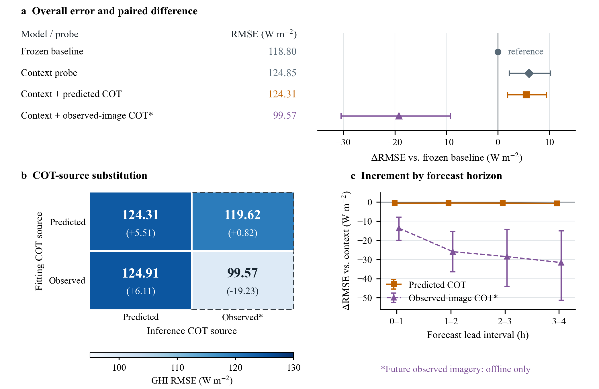

**图S1：预测图与真实图输入下的COT信息。 (a) GHI RMSE及相对冻结预报基线的配对差值；该基线已使用历史COT。上下文组为固定线性残差探针，输入预测AGRI、几何、历史COT、时效和基线输出；另外两组加入未来COT。(b) 复用已拟合探针并交叉替换COT来源；单元格为RMSE，括号为相对冻结基线的差值，虚线框推理列需要未来观测。(c) 各预报时效区间相对上下文探针的差值，0–1 h包含+15至+60 min。所有面板使用50个开发日期的32,838条共同记录，按日期块做折外拟合。先对三站与三份冻结基线来源分别计算RMSE，再等权平均。误差线为5,000次目标日期簇bootstrap的配对95%百分位区间。真实图COT是冻结反演器处理实际未来AGRI得到的代理，只作离线诊断，既非独立云真值，也非可部署输入。负差值表示误差较低。**

### S3 同一事件的三站轨迹

图S2保留此前预报来源诊断的三站轨迹，初始化为2025年8月6日北京时间12:00。该日为三站均覆盖的最早合格修正开发日期，初始化取最接近正午的有效时刻。该诊断使用历史COT基线和固定残差映射，与图6的当前同期模型不同。无有效15分钟GHI标签时保留断线。三站曲线描述同一事件，不是三个独立重复，也不代表总体COT收益。

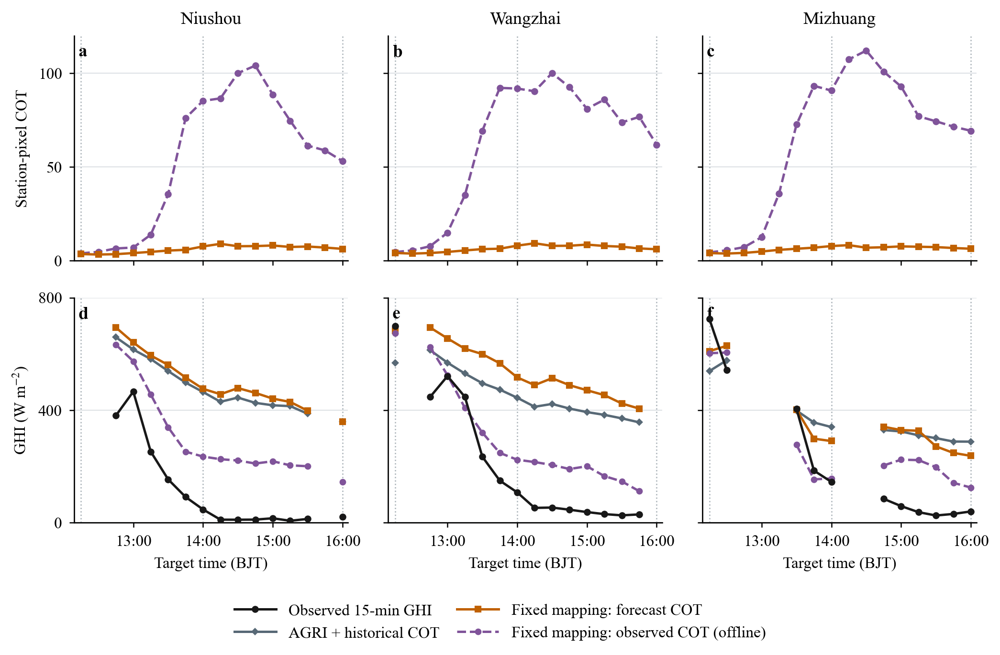

**图S2：同一日历规则事件中牛首、王寨、米庄的站点像元COT（a–c）及GHI（d–f）。紫色虚线使用实际未来AGRI反演的COT，仅作离线诊断；橙色实线使用SimVP图像反演COT。两种GHI来源评估使用同一真实图COT训练的残差映射。灰色为已有AGRI加历史COT基线，并非无COT对照。三站分别有13、14、11个可评分GHI区间，缺项保持断线；每排共享坐标范围。展示曲线为该历史诊断三份冻结基线来源的均值；实际未来AGRI反演COT仅用于离线诊断。**

### S4 原太阳几何预处理下的同期比较

这些比较使用原太阳几何预处理下拟合并保存的模型。湖北CPP监督已正确匹配UTC，但反演输入与GHI几何仍采用原预处理。湖南单帧比较也保留原几何及已选定权重，统一排除无效站点日。它们是可复现的特定配置验证结果，不是主文已核验几何的同期评分；湖北厚度分层与其总体比较同源。

原几何条件下，两个区域验证集的单帧GHI误差均因加入COT而降低（图S3）。湖北的站点与种子等权RMSE由77.285降至69.142 W/m²，降低10.54%；配对差为−8.143 W/m²，95%两日日期块区间为[−14.999,−3.361]。MAE由56.616降至46.723 W/m²，正偏差由24.799降至13.236 W/m²。评价包含10个两日日期块内2,195条站点—时次记录及三次随机初始化。三站平均误差均下降：牛首由76.851降至63.978，王寨由70.539降至63.137，米庄由84.466降至80.312 W/m²。

湖南单帧补充比较包含51个目标日期内4,440条站点—时次记录。RMSE由108.181降至103.995 W/m²（3.87%），配对差为−4.187 W/m²，95%日期块区间为[−6.652,−1.855]。四里由103.558降至99.877 W/m²，竺家由112.805降至108.113 W/m²。该比较以这些预处理配置为条件，不能分离太阳几何修正的作用。

湖南表示对照为上述改善提供了背景（表S3）。额外图像特征的RMSE为108.014 W/m²，与基线接近；反演模型特征的RMSE为103.456 W/m²，与显式COT相近。因此，云监督特征不必仅以光学厚度输出的形式发挥作用。结果支持COT是该配置下有用的表示，但不能确定全部收益独属于显式厚度。湖北连续云概率对照的RMSE为74.053 W/m²；同时加入云概率与COT为68.815 W/m²。相对单独加入COT，额外降幅为0.47%，95%区间为[−1.23,2.62]%，未显示明确的总体增量。

**表S3：湖南单帧表示对照，采用相同4,440条验证记录。RMSE对两站和三次随机初始化等权平均。**

| 输入表示 | RMSE（W/m²） | 降幅（%） |
|---|---:|---:|
| AGRI＋太阳几何 | 108.181 | — |
| 额外图像特征 | 108.014 | 0.15 |
| 显式COT | 103.995 | 3.87 |
| 反演模型特征 | 103.456 | 4.37 |

**图S3：真实云图输入下逐站GHI反演误差，按三次随机初始化平均。湖北2,195条、湖南4,440条记录；两区域样本与模型独立。**

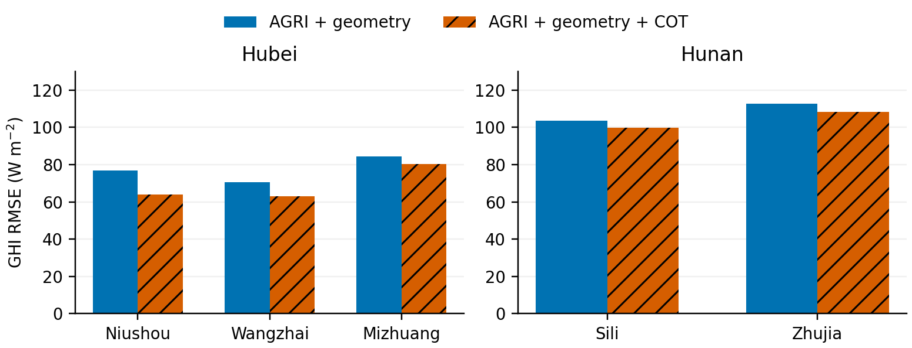

湖北参考产品覆盖的子组呈现明显的厚度依赖（图S4）。近零、薄云、中等厚度和厚云条件的RMSE分别由88.704降至85.145、116.483降至106.130、77.587降至75.281、57.139降至34.527 W/m²，对应降幅为4.01%、8.89%、2.97%和39.57%。厚云子组包含4个两日日期块内173条站点—时次记录，降幅95%区间为[28.04,50.05]%。近零、薄云和中等厚度子组分别包含268、71、211条记录，覆盖6、3、5个日期块，其降幅区间均包含零。总体GHI评价还包含无CPP参考的记录，因此并非这四个子组的加权平均。

厚云子组的平均偏差由+36.097降至+6.093 W/m²，与纠正强衰减条件下过高的透射辐照度相符。但这并不意味着统一向下修正：中等厚度子组的偏差由+14.490变为−11.023 W/m²，近零子组则由+6.218增至+14.284 W/m²。米庄近零COT子组的RMSE由114.775升至118.948 W/m²。因此，总体收益可与特定站点和云况下的退化并存。各档降幅并不单调，加上参考覆盖有限，不能推导收益随厚度连续增大的普遍规律。

**图S4：湖北站点中心CPP COT分层的GHI误差（左）及加入COT后的RMSE降幅（右）。误差棒为95%配对两日日期块区间；标注为站点—时次记录数及日期块数，并非独立像元数。**

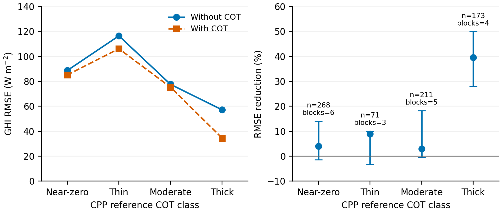

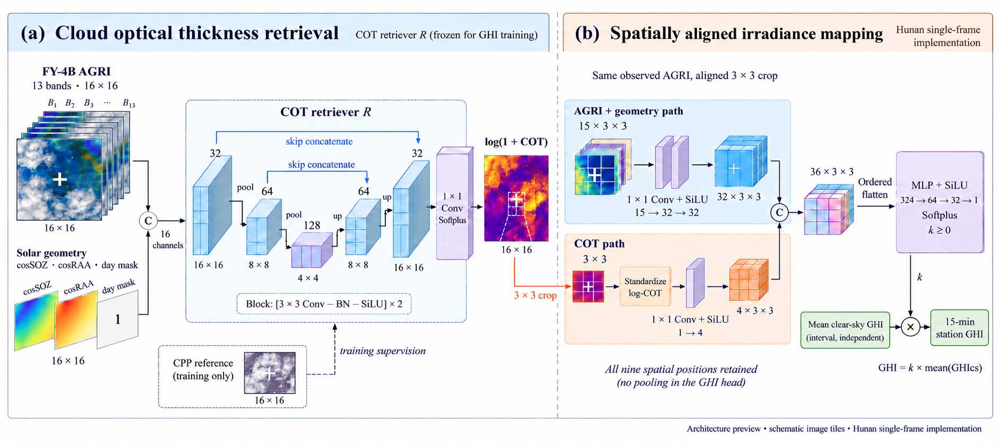

**图S5：单帧 COT 辅助 GHI 估计，以湖南实现为示意。16×16 AGRI 与几何上下文进入 U-Net，非负对数 COT 输出转换为物理 COT。GHI 模型读取对齐的3×3 AGRI、几何和标准化对数 COT，经有序拼接、展平与读出得到晴空指数，再乘区间平均晴空 GHI。虚线表示监督，云图纹理为示意而非观测。本图为 AI 辅助视觉预览；区域模型规模与湖北辅助槽变体见表 S1。**

### S5 湖北预报专训及固定输入替换

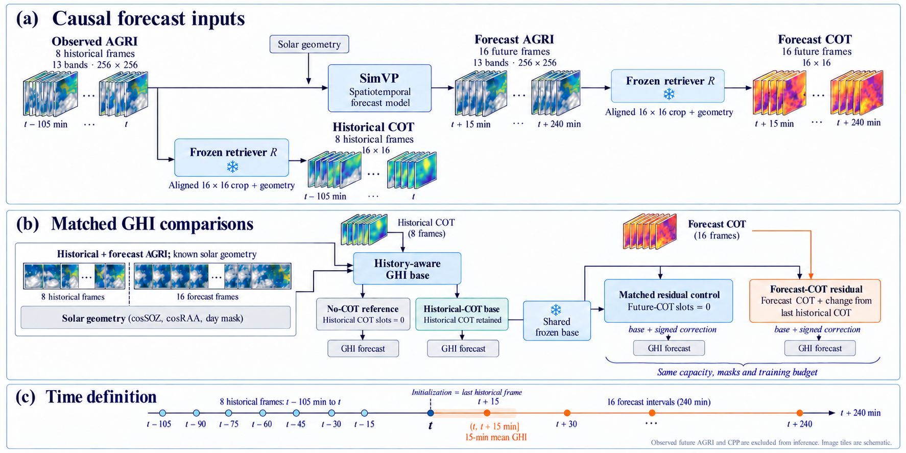

**图S6：预报对照及因果输入流程。8帧真实历史 AGRI 用于图像外推和历史 COT；SimVP 产生16帧未来 AGRI，固定反演器生成未来 COT。四臂分别为无 COT、历史 COT、匹配控制修正及预测 COT 修正。后两臂共享冻结历史 COT 基底；控制臂将未来 COT 槽置中性零以保持修正容量。修正有正有负，输出零初始化并由门控调节；未来 COT 不可用时回退基底。未来真实图像与 CPP 不进入该推理流程。张量图为示意，不是测量；GHI图像分支为13个AGRI通道加2个几何通道，共享几何栏中的白天指示量用于反演与有效性掩膜，不是额外的GHI图像通道；输入定义见表 S2。**

四臂输入及训练预算见补充表S2，与湖南同期训练三帧模型的直接回放分别报告。

预报专训比较分别拟合无COT与八帧历史COT基底，再冻结历史COT模型，在另一组修正训练日期拟合两个同容量门控残差头。控制头的未来COT槽为中性零，另一个头读取预测AGRI反演的未来COT；二者共用样本、几何、顺序和预算。有符号修正采用零初始化输出层，最终晴空指数非负。基底及修正阶段均为30轮、batch 1,536，AdamW学习率10⁻³、weight decay 10⁻⁴，余弦衰减至10⁻⁵，种子42、43、44。该实验是专门训练的预报比较，不是同期模型权重直接回放。

预报专训对照使用2025年8月22日至2026年6月29日之间选定的22个验证目标日期、15,275条共同站点—初始化—目标时刻记录。历史COT使站点与种子等权RMSE由105.595降至103.670 W/m²，点降幅1.823%；配对差−1.925，目标日期块95%区间[−4.734,+0.670]，本分析未能将该改善与零区分。

在修正头加入未来预测COT后，RMSE由同容量控制的103.783变为103.808 W/m²，配对差+0.026，区间[−0.003,+0.059]。完整16时效图将种子变化与日期块不确定性分开。该比较未显示未来COT额外增益，也不证明等效或普遍无价值。

**表S4：预报精确结果，共同验证样本上的GHI RMSE，W/m²。每格为三seed分别评分后平均，末行进一步对站点等权；后两臂共用历史COT基底。**

| 站点 | 无COT | 历史COT | 历史+控制修正 | 历史+预测COT |
|---|---:|---:|---:|---:|
| 牛首 | 97.017 | 96.299 | 96.665 | 96.701 |
| 王寨 | 106.183 | 102.892 | 103.165 | 103.215 |
| 米庄 | 113.586 | 111.819 | 111.519 | 111.510 |
| 站点等权 | 105.595 | 103.670 | 103.783 | 103.808 |

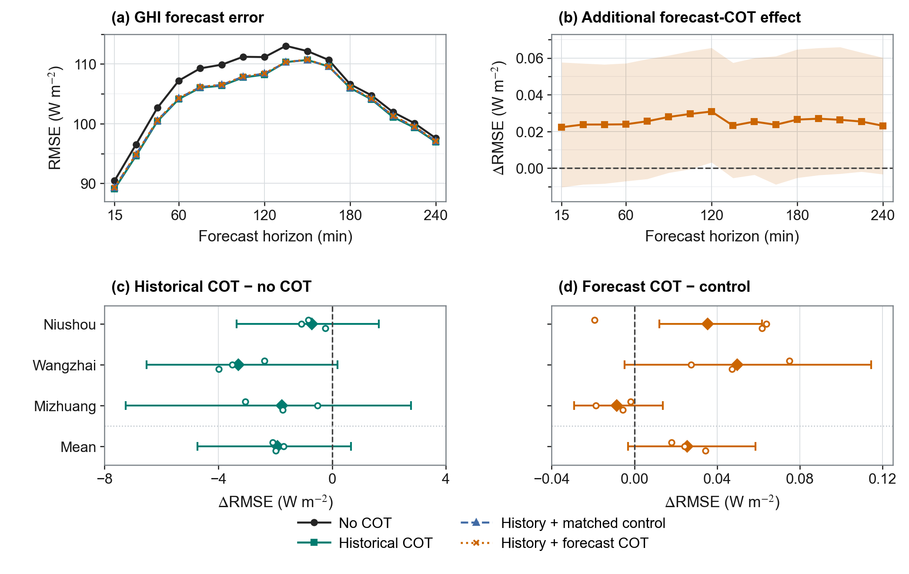

**图S7：22个验证目标日期、15,275条共同站点—初始化—目标时刻记录上的 GHI 预报评价。(a) 四种模型在相对历史末帧+15～240分钟的 RMSE。(b) 未来 COT 修正减同容量控制修正，阴影为逐时效目标日期块配对95%区间。(c,d) 历史 COT 减无 COT、未来 COT 修正减控制修正；行序相同，为牛首、王寨、米庄和三站等权。菱形为三个种子分别评分后的均值，空心圆为单种子，横线为5,000次配对日期块bootstrap的95%区间；负值改善，面板尺度不同。后两模型共享冻结历史 COT 基底，推理不含未来真实 AGRI 或 CPP。这是开发验证，不是独立测试。**

另一组固定头诊断使用12个开发目标日期的8,111条共同可替换记录。该诊断的控制已含历史COT。用真实目标时刻AGRI替换预测AGRI，使控制RMSE由103.469降至89.441 W/m²，差−14.028、区间[−21.911,−6.053]。然而，在预测AGRI与真实AGRI条件下分别加入同源未来COT，差值为+0.025和+0.140，两区间均跨零。因此较好的云图信息与该映射相关，但将真实图与真实图COT联合输入，并未恢复固定头中的COT增量。

**表S5：固定头MSE分解。** O表示真实图来源，F表示预测图来源；同一8,111行，单位W²/m⁴。点估计满足式(10)，区间端点不能相加。

| 对比 | 点估计 | 配对95%区间 |
|---|---:|---:|
| E_FO−E_OO | 2778.1 | [938.0,5228.9] |
| E_OF−E_OO | −5.4 | [−48.9,33.5] |
| E_FF−E_FO−E_OF+E_OO | −51.6 | [−109.2,−7.8] |
| E_FF−E_OO | 2721.1 | [920.4,5105.2] |

图像来源项在这个条件比较中较大，交互项也非零。它们是特定固定映射的敏感性，不是独立物理误差预算。替换样本与预报验证队列不同，不能把两者绝对分数差当验证到oracle收益；这些对照与单个云事件都不能唯一指定云团位移、厚度增长或反演行为为原因。

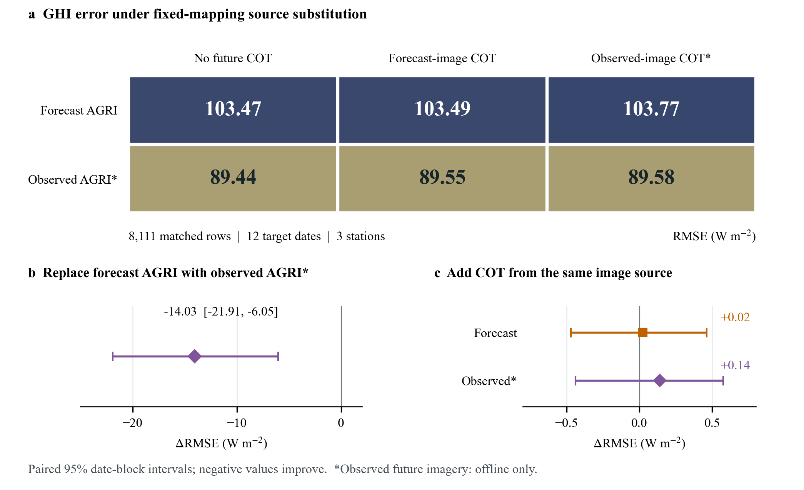

**图S8：固定辐照度映射对云图与COT来源的敏感性。(a) 12个开发目标日期、8,111条共同可替换样本，三个站点各三个种子的GHI RMSE分别计算后等权汇总。各分支均保留历史COT，“无未来COT”仅去除额外的未来COT修正输入。(b) 在该控制组中以真实目标时刻AGRI替换预测AGRI。(c) 相对相同AGRI来源的控制，加入来源匹配的未来COT。区间为5,000次目标日期块配对bootstrap的95%区间；(b)(c)横轴范围不同。未来真实AGRI及其反演COT仅供离线诊断，结果不构成独立评价或可部署预报收益。**

### S6 湖南共同样本上的底图比较

两种底图使用相同的真实图训练三帧辐照度模型，比较保留51个目标日期的63,480条共同验证记录。它与表4、图7扩展后的区域DyDiff比较分开报告。两种方法加入预测COT后的RMSE差值点估计均为负，但该比较不能确定哪种底图的COT增益更大。

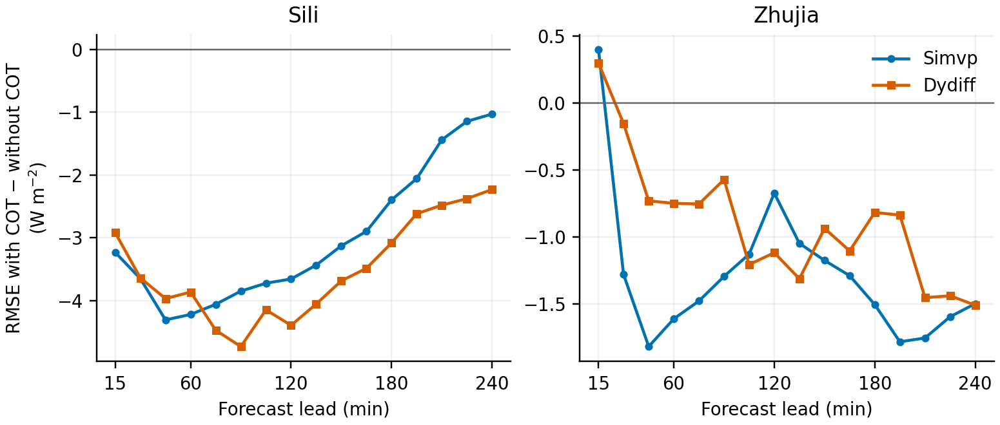

**图S9：湖南两种底图加入预测COT后的逐时效GHI RMSE变化，评价范围为51个日期的63,480条共同验证记录。每个点为同一站点、同一时效下三个种子RMSE差值的均值；负值表示COT改善。曲线为验证点估计，本图不显示逐时效置信区间。**
