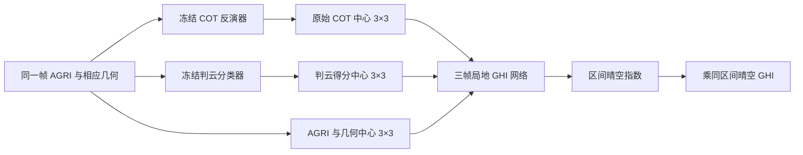

# 云状态与 COT 联合输入 GHI 的详细计划

日期：2026-10-20。状态：**四组配对训练及 FP64 总体/分层评分完成；主比较 C1 未通过冻结判据，二值表示 B3 不启动。** 本计划承接同期 COT 价值主线，不改变第一篇外推研发。结果见 [B2结果报告](B2_RESULTS_20261020.md)。

问题：判云信息能否帮助 GHI 网络区分晴空伪云、薄云和厚云，在已有 COT 上提供增量？

方法假设：保留原始 COT，在同一位置、同一三帧中额外提供连续判云得分，让现有局地网络学习两者的关系。

依据：[文献与方法选择](LITERATURE_METHOD_DECISION_20261020.md)、[已完成实验与去重清单](HISTORY_AUDIT_20261020.md)。文献支持云状态/厚度分开表达及云掩膜特征输入，但没有直接证明本项目具体接法有效。

## 1. 两个科学问题与判定

| 问题 | 为什么做 | 最少需要的证据 | 对应实验 |
|---|---|---|---|
| C1：已有AGRI+COT时，增加判云信息是否改善同期GHI？ | 检验云掩膜的实际价值，而非只让COT图更干净 | 相同样本、网络、训练预算下，有无判云的三seed配对；总体、逐站和日期块区间 | B1、B2 |
| C2：已有AGRI+判云时，COT是否仍有额外价值？ | 区分“只需要知道有没有云”与“还需要云多厚” | 联合输入与仅加判云的配对，厚度分层及真实连续事件 | B1、B2 |

主文如采用本实验，应围绕这两个问题写；旧阈值扫描、接口核查和资源记录留工程文档。不预写正向结果，不把分类误报下降当GHI收益。

## 2. 复用什么，什么不重复

复用现有日期清单、原始AGRI、标签、晴空区间值、修正几何、修正几何R、三帧3×3 GHI头、已存OOF判云数组与分类器。远端元数据已确认54,895个所需站点-帧键全部可匹配。

不重新做近零COT加权、两阶段hurdle、参考晴空清零、0.5硬门控、0.2935079336保守门控及其GHI重训。旧“清零后重训GHI”已做且未证实收益，不能作为本轮新任务。

本轮需要重训四组小GHI头，因为现有训练没有独立判云通道，并且新实验从训练选模开始统一排除已确认的无效观测日。旧分数只能作为复现锚点，不能直接与新增通道成绩拼成配对结果。

## 3. 明确输入与物理语义

设 `T` 为GHI标签15分钟区间的结束时刻，使用真实观测名义时刻 `T−30、T−15、T` 的三帧：

\[
Z_t(r,c)=[X_{1:13,t}(r,c),\ g_{1:2,t}(r,c),\ C_t(r,c),\ P_t(r,c)],
\]

\[
C_t=\{R_{\log}(X_t)-\mu_C\}/\sigma_C,
\qquad P_t=p_{\rm cloud}(X_t)-0.5.
\]

其中R_log输出已是log1p(COT)，只归一化，不再重复log1p。物理COT展示时才用expm1。`p_cloud` 是冻结分类器0–1得分，中心化只是固定数值变换；不把它解释成面积云量、辐射透过率或已校准的COT可靠度。

每帧13个AGRI＋当前头已有2个几何通道＋1个COT＋1个判云，共17通道。保留全部3×3位置与三帧，不做全图均值、p90或GAP。判云与R可在其原生16×16输入上推理，然后取中心 `[7:10,7:10]`；不得把R输入改为3×3。

图中“相应几何”指各冻结模型原训练时的输入版本：本轮R/GHI几何已修正；现成判云得分是旧分类器在其自身旧几何/归一化下产生的。首轮只复用得分，不向旧分类器临时改喂新几何；不能声称它是修正几何分类器。后续若研究重训分类器，独立命名、重新生成OOF，并保持GHI其他设置不变。

该三帧实验是**同期离线GHI估计**。名义T图像的实际扫描或可用时间可晚于T；不称实时预报。未来应用需要另核实初始化时刻可获得的输入。

## 4. 四组配对比较

| 标识（仅工程记录） | 输入 | 固定零槽 | 用途 |
|---|---|---|---|
| M00 | AGRI＋几何 | C=0、P=0 | 公共基线 |
| M10 | AGRI＋几何＋COT | P=0 | 现有COT路线的匹配基线 |
| M01 | AGRI＋几何＋判云 | C=0 | 判云能否独立提供信息 |
| M11 | AGRI＋几何＋COT＋判云 | 无 | 检验两者联合 |

所有组都分配17个通道槽和相同网络。这里的零表示该标准化特征槽不存在，不是把物理COT=0或判云p=0输入为晴空。真实晴空/低得分应按自身数值转换后输入，缺测不得填0冒充晴空。

主比较是M11−M10；次比较是M11−M01；M01−M00及M10−M00完整报告作背景。比较量为RMSE差，负数为改善。不只展示最有利的一对。

相同参数槽控制名义网络容量，不意味着控制了全部有效表示能力。R和分类器都是同源AGRI的派生表示，且使用较大上下文；因此即使有效，也只说明加入这种云状态/COT表示有价值，不能证明新增独立观测或唯一物理因果。

## 5. 每层怎么走

| 层 | 输入→输出 | 保留内容 |
|---|---|---|
| 拼接 | `[B,3,17,3,3]` | 三帧、逐像元、17槽 |
| 维度换位 | `[B,17,3,3,3]` | 不改变时空位置 |
| Conv3d＋SiLU | 17→32，核`(3,3,3)`，padding`(0,1,1)`；输出`[B,32,1,3,3]` | 一次学习三帧局地联合特征 |
| squeeze＋Conv2d＋SiLU | `[B,32,3,3]`→同尺寸，3×3核、padding1 | 局地空间关系 |
| 展平＋Linear＋SiLU | 288→64 | 所有3×3位置各自保留 |
| Linear＋Softplus | 64→1 | 非负区间晴空指数，不截上界 |
| 辐照度换算 | `pred_GHI=pred_k×mean(clear_GHI)` | 对应同一个15分钟区间 |

源实现是 `experiments/r_geometry_downstream_ghi_20261016/train_three_arm_ghi.py::IntervalHead`。原16槽41,665参数，17槽42,529参数；新增864个第一层参数，四组完全相同。这是三帧小卷积头，不是旧四层因果空洞3D网络。

每个站/seed复制同一份初始化，COT和判云两槽的首层权重置零，使四组初始输出完全相同，但非零特征仍能通过对应首层权重梯度参与学习。共享层权重必须实际复制，不能只依赖设置相同随机种子。

## 6. 数据与训练设置

- 划分：`hunan_monthly_block_2d_buffer1d_seed42_v1`。仅train/validation，test不读取。
- 现存包：47,666 train、4,263旧val；按观测日清单删除四里2024-09-05全部37条三帧GHI行后，val应为4,226。四里train22,930/val1,999，竺家train24,736/val2,227。四组同一行顺序、标签和白天规则。
- GHI标签为时间戳T−10、T−5、T标记的三个5分钟区间均值的平均，完整覆盖`(T−15min,T]`；这些时间戳表示区间结束，并非三个瞬时采样。晴空GHI同区间。实测GHI不作为输入。
- AGRI沿用现存train拟合归一化，几何沿用同一数据包。COT沿用已核实三臂实验`setup.json`中公共train均值1.8354828989218208、标准差1.3974485910139944，四组不分开重新拟合。
- 判云不再拟合验证阈值，不做新概率校准，直接用已存得分减0.5。训练有CLP监督日期使用日期OOF分类器输出；无监督train日期及val使用原full-train分类器，保留来源映射。
- 独立训练两站，seed42/43/44，四组×三seed×两站=24次小头训练。全部种子预算预定，不按seed42正负只保留有利种子。
- AdamW：lr1e−3、weight_decay1e−4；30个完整epoch，cosine到1e−5；梯度裁剪5。损失`mean(((pred_GHI−GHI)/1000)^2)`，不另加判云或COT损失。
- 有效batch1792、保留尾batch：四里每epoch13次更新、总390次；竺家14次、总420次。同站四组同一30份shuffle顺序、优化器和更新数。
- 每epoch在已经应用无效观测日规则的val上按GHI RMSE选best，相同最优时取最早epoch；同时保留last和全曲线。不能按某组最好时效/天气另选checkpoint。该val已多次使用，后续CI均为探索性验证，不冒充独立test。

## 7. 执行块与交付物

### B0：复用与最小接口准备（CPU为主）

不重复历史已通过审计。将现有probability数组按`(station,exact UTC frame time)`连接到三帧的每个时刻，核对中心位置和源array摘要。读取`p_cloud.npy`，**不能读取同目录`cot_log1p.npy`当原始COT，它已经被硬门控**。

检查有限值、范围、站点/时刻、四组相同行及OOF来源；分类参考只用有效CLP0/1/2。一次统计得分分布、Brier score及固定分箱可靠性，按站/季节显示样本量，不把未校准得分直接当物理概率。若发现类别颠倒、常数输出或错位，先修具体问题；校准不完美本身不构成反复调旧val阈值的理由。

输出：资产/键及几何对照见`REMOTE_PREFLIGHT_AUDIT_20261020.json`；训练器运行时另写入`input_source_manifest.json`、`setup.json`和`gpu_smoke_receipt.json`。54,895个所需站点-帧键均匹配；旧分类器几何版本差异已量化并保留为输入来源限制。

### B1：四组24次配对训练（完成；PBS 215069.tc6000）

一次性加载训练/验证包到内存或显存，用同一张卡顺序运行；不逐epoch重复扫共享盘。初始函数相同、COT/P两槽可求导和checkpoint重载各做一次必要检查。实际模型不更新R或分类器。

输出：每个站/seed/组的best、last、epoch曲线、训练参数、逐样本预测及完成记录。核心表：四组等站三seedRMSE、逐站、MAE、bias及预定差值。

### B2：统计、参考分层与真实事件解释（核心数值完成；真实事件图待整理）

主量先分别计算每站每seed所有有效行RMSE，再对站和seed等权，不先平均seed预测造集成成绩。百分比使用`100×(baseline−candidate)/baseline`，分母和样本范围明确。

以冻结月度验证的连续2日块为重采样单位，两站和全部方法/seed共享抽样块，重复2000次；被排除站日保持缺失，不能补回。保存块定义和随机种子20261020。分层bootstrap从完整26块中抽样；仅拒绝某个站/seed在该分层没有样本的抽样重复。总体分层重算区间与主评分完全一致。若要复现旧按日CI，单列敏感性，不混作同一统计量。种子只报告稳定性，不能把3seed×样本行数当独立天气样本。

判定顺序：
1. C1支持条件：M11−M10三seed均值为负、至少2/3seed等站改善、两个站三seed均值均不退化，日期块95%CI上限<0。
2. C1未达到时完整报告“未证实增量”，不扩网络/seed/阈值搜索。均值改善而CI跨0只能称当前点估计改善。
3. C2使用同样规则评价M11−M01；C1未通过时，C2及其他比较为描述性结果，不挪作掩膜成功证据。两项都通过才讨论互补增益。

分层沿用已经冻结的参考边界：近零[0,0.1)、薄云[0.1,5)、中等[5,30)、厚云[30,100]；来源为`scripts/plot_group_cot_thickness_rmse_20261016.py`的既有分组，不重新调边界。同时保留CLP晴/云与COT厚度标签，不把两者互换。按GHI≥800 W/m²报告高值bias/MAE和新增/减少SSE；参考缺失行仍进入总体GHI评分。

图件：①总体点估计及配对区间已见结果报告；②CPP COT各层和CLP各类配对差图已完成；③GHI≥800 W/m²子集的bias/MAE/SSE诊断已完成并保存；④真实三帧AGRI伪彩、原始COT、判云得分/参考掩膜、区间GHI曲线仍待按固定旧失败案例和固定时间规则整理。分层结果基于CPP/CLP共同有效的1,265/4,226行；缺参考行仍在总体GHI评分中，不作云况归类。图注区分参考、估计和缺测，不用合成云图解释真实训练成绩。

### B3：仅在B1/B2支持后做的一个表示对照（可选）

将M11的连续得分换成`1[p>=0.5]−0.5`作为额外通道，COT仍不清零，其余完全相同。这才回答连续得分是否优于二值掩膜。预定阈值0.5，仅作表示比较，不重新筛选阈值；不把旧0.2935硬门控成绩当这组结果。额外6次训练；与保留的匹配M11比较，不另扫多阈值。

### B4：区域重复与预报应用（条件后续，当前不启动）

湖南同期限度内有支持后，按独立湖北日期、R与分类器来源重复，不迁移湖南权重。预报则在固定已有外推链、同初始化/目标/时效的样本上再做有无云状态配对；未来判云必须来自初始化前历史的外推结果，不能拿真实未来CPP/AGRI掩膜代替。

当前没有把“观测图像的判云得分”定义成未来可用输入。若固定历史COT输运路线尚无匹配的因果未来判云场，须先另定其生成方式和同训练/推理分布；不自动增加一个新外推模型，也不把本轮同期训练头直接插入预报后宣称预报增益。

## 8. 运行顺序、计算与停止

| 顺序 | 任务 | 状态/运行数 | 下一步依据 |
|---|---|---|---|
| 0 | 历史去重、文献、旧门控按新观测日重评分、资产键核查 | 已完成；0 GPU训练 | 见本目录证据 |
| 1 | 连接已存判云、17槽接口、固定配置 | 几何/时空键预审PASS；模型GPU梯度与首批次检查随同一任务执行 | smoke通过 |
| 2 | 四组两站三seed | COMPLETE；`215069.tc6000`；node22 A800 GPU4；24/24完整 | 转B2 |
| 3 | 配对统计和参考分层 | CORE_NUMBERS_COMPLETE；FP64总评、日期块CI、CPP COT/CLP分层、高GHI诊断和配对差图已完成；真实事件图待整理 | C1未支持；B3关闭 |
| 4 | 连续/二值表示 | CLOSED_NOT_RUN | C1冻结判据未通过，不扩实验 |
| 5 | 湖北重复/预报应用 | 有条件，需各自明确来源 | 不扩大本轮24次主预算 |

已有同类18次三帧头训练记录约80.37秒，仅为模型训练循环的历史观测，不是当前端到端ETA。首轮预留不超过0.5–1单卡GPU小时（含启动、载入、接口与24次训练），实际速度由第一次运行记录；超过预算先定位I/O/启动问题，不盲目加卡。

已有判云约57MB，元数据已证实齐全；主要准备是一次精确连接，不需要重产全年CPP/R。单卡优先优化驻留与加载，不为“多占显存”扩大有效batch减少更新数；若microbatch改变，梯度累积维持1792有效batch和相同更新次数。

后续执行前实时核查slfu全队列，最多3个未结束PBS任务，单卡资源根据当时可用情况选择。`node22 A800`属于浙师大学院服务器，不称复旦。简单监控交Luna；本次仅规划，不新建自动化或提交任务。

科学停止：C1无支持则关闭当前“独立判云输入”配置；实现失败则保留日志，修复具体错误后新attempt，不改评价规则。只缺参考CPP不停止总体GHI实验；缺真实输入概率需修复生成/连接，不能填晴空或有利筛样。

## 9. 工程来源索引

服务器共同根：`/public/home/slfu/ttzhou/swc/irradiance_forecast/SolarCOTIFS_20260907/experiments/`。

| 资产 | 相对共同根的路径 |
|---|---|
| 三帧AGRI/几何/GHI | `cot_interval_history_20261015_v1/data_attempt2/` |
| 修正R的原始COT | `r_geometry_downstream_ghi_20261016/data/paired_r_cot_bank_v1/cot_corrected_log1p.npy` |
| 旧分类器判云得分与键 | `monthly_R_station16_20261013_v1/results/conservative_gate_cot_bank_20261015_attempt1/`，只取`p_cloud.npy`及键/来源 |
| OOF/full分类器 | `monthly_R_station16_20261013_v1/c1_conservative_gate_20261015/output_attempt3/` |

本地公共COT标度：`experiments/r_geometry_downstream_ghi_20261016/results/paired_three_arm_v1/setup.json`；公共无效日规则：`docs/GHI_STATION_DAY_EXCLUSIONS_20261019.json`和`scripts/station_day_quality.py`。完整已核实摘要见`ASSET_AVAILABILITY_20261020.json`，不是新训练完成记录。

新训练建议目录为`experiments/cloud_probability_input_20261020/attempt1/`，不得覆盖旧bank、旧分类器及旧头。保存方法、数据键、权重来源、代码、逐样本预测和图表索引即可，不增加与科学判断无关的审批链。

## 10. 本轮完成核对

- [x] 核对过去云掩膜实验，区别无效实现、oracle、COT改善和GHI收益。
- [x] 阅读有直接方法关系的原文，标明全文与摘要的区别。
- [x] 分开分类得分、覆盖面积、COT、透过率、云影与缺测。
- [x] 两个主问题、四个最小配对输入，训练与选模规则明确。
- [x] 先3×3三帧同期结果，外推和区域重复条件后置。
- [x] 远端只读核验分类器太阳几何来源与全部三帧站点键；发现旧几何版本，已明示并保持冻结概率原样。
- [x] 17槽训练代码通过本地语法、远端CPU前向和GPU更新见证；PBS `215069.tc6000` 已完成24/24训练。
- [x] 保存预测经FP64独立复算；总体四组、两站、三seed、共享日期块配对区间完成。
- [x] CPP COT厚度、CLP类别和GHI≥800 W/m²诊断完成；结果及边界见`B2_RESULTS_20261020.md`。
- [x] C1/C2按预先规则判定；C1未支持，B3二值对照不启动，湖北和预报应用保持条件后续。
- [ ] 真实连续云事件图：按冻结时间顺序/固定旧案例继续做；不影响四组训练完成和C1判定。
