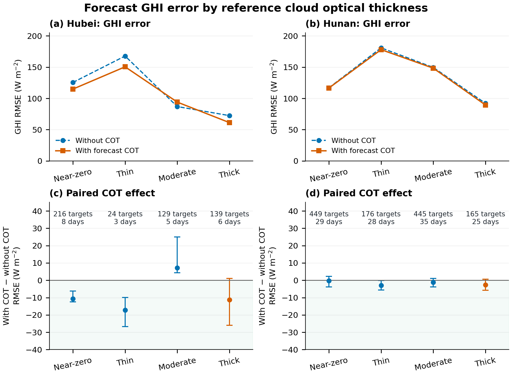
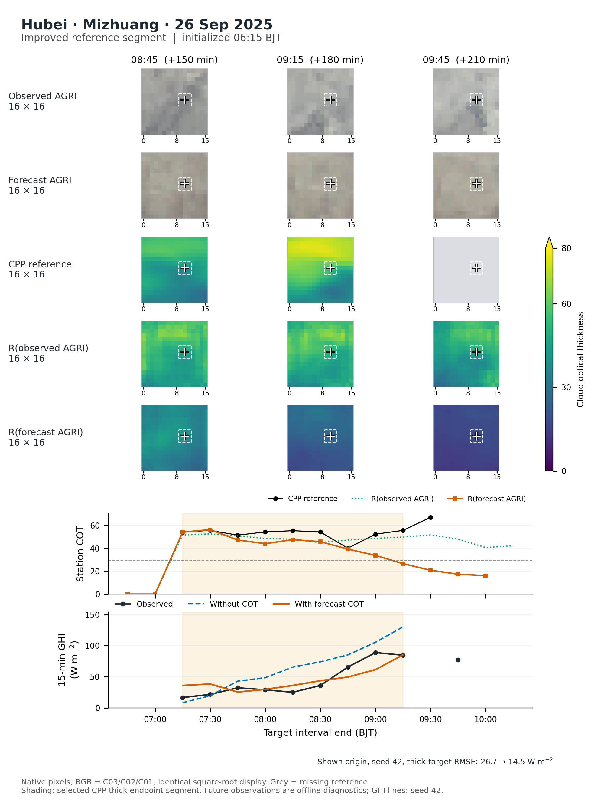
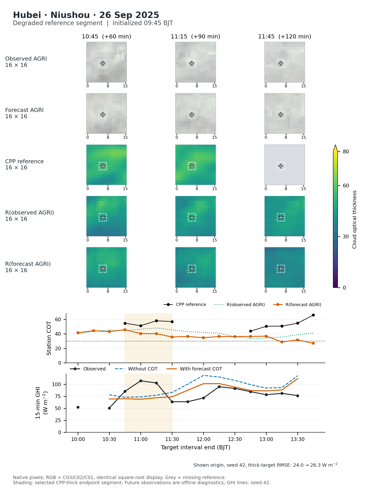
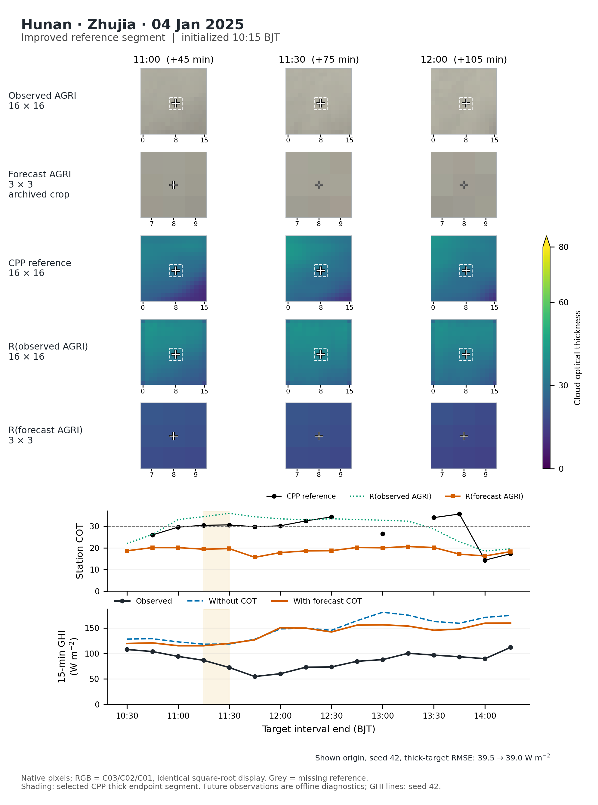
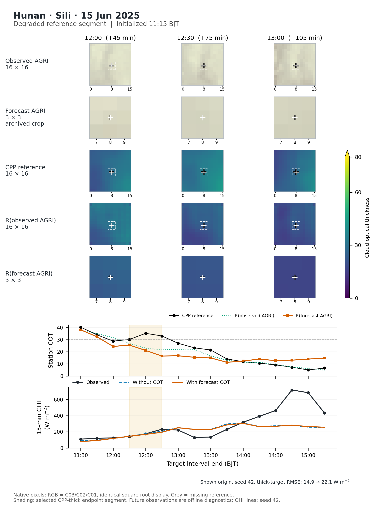

# 湖南、湖北预报厚云分层与真实连续案例

2026-11-02。使用现有真实图训练冻结头及保存预测；没有训练、没有新模型推理、未改总体样本/掩膜，test/buffer关闭。总体指标复现湖北101.018→96.071、湖南122.588→120.502 W/m²。

## 1. 分层结果

CPP是检索参考。按质量有效的站点像元、目标时刻COT分为[0,0.1)、[0.1,5)、[5,30)、[30,100]；近零不自动等同真实晴空。分层只用于离线评价，未进入预报输入。GHI为以目标时刻结束的15分钟平均，端点CPP厚云不等于整个15分钟都厚云。

|区域|CPP分层|无COT RMSE|加预测COT RMSE|降幅|ΔRMSE日期块95%区间|独特站点目标/日期|
|---|---|---:|---:|---:|---|---:|
|Hubei|Near-zero|125.562|114.917|8.48%|[-12.479, -6.263]|216/8|
|Hubei|Thin|167.814|150.562|10.28%|[-26.761, -9.984]|24/3|
|Hubei|Moderate|86.965|94.089|-8.19%|[+4.320, +24.961]|129/5|
|Hubei|Thick|72.479|61.281|15.45%|[-25.927, +1.089]|139/6|
|Hunan|Near-zero|116.959|116.627|0.28%|[-3.898, +2.337]|449/29|
|Hunan|Thin|180.939|178.056|1.59%|[-5.657, -0.049]|176/28|
|Hunan|Moderate|149.587|148.408|0.79%|[-3.777, +1.085]|445/35|
|Hunan|Thick|92.134|89.464|2.90%|[-5.821, +0.690]|165/25|

单位W/m²。各站、各seed先算误差再等权，非先平均预测成集成；均值、seed SD、MAE/Bias及逐时效值见strata_metrics.csv，逐站见station_strata_metrics.csv。日期块保留同一天重叠初始化的相关记录。区间是5,000次目标日期重抽样，不能当作独立test或每条记录独立；未定义固定单元的抽样会明确计数而不填0。当前总体各厚云比较5,000次均定义。

**当前判断：** 湖北厚云点降幅15.45%，湖南2.90%，但两省厚云区间均跨零，不能宣称已证明稳定厚云增益。湖北中等厚度组有退化（86.965→94.089 W/m²，正向差值区间）；这是必须同时展示的失败条件，不能只展示厚云收益。分层支持少且非随机缺测，不能将该子集百分比推广至全部预报或当作总体分数的简单加权组成。

湖北预报厚云的GHI平均偏差由+31.986降至+16.072 W/m²，湖南由+34.456降至+22.821 W/m²；这与降低正偏差相符，但不能证明云影、散射或时间误差的唯一因果作用。

## 2. 覆盖与归并

|区域|全部预报行|CPP有效行/全部|CPP有效独特站点目标|厚云预报行|厚云独特目标/日期|厚云参考段|至少2个相邻参考时刻的段|
|---|---:|---:|---:|---:|---:|---:|---:|
|Hubei|24451|7976 / 24451 (32.6%)|508|2141|139/6|75|18|
|Hunan|66086|18750 / 66086 (28.4%)|1235|2435|165/25|137|7|

相同站点目标时刻跨初始化只判一次参考类别，再按连续15分钟厚云端点连接，缺参考/非厚云/时间中断即分段；预报评分仍保留全部原行。表中是**站点CPP支持连续段，不是独立物理云团**。湖南137段中130段只有一个参考时刻，明显受参考稀疏和阈值穿越影响；不能据此估计独立天气事件发生率或把段数当独立样本量。各段目标时刻等权的增益见events.csv；跨站天气相关性仍以日期块处理。

目标时刻等权敏感性下，厚云RMSE：湖北72.559→61.234、湖南90.838→87.570 W/m²，方向与主统计一致。逐一删除任一日期，厚云ΔRMSE范围湖北[−14.616,−6.830]、湖南[−3.720,−2.147]；这属于影响诊断，不能替代跨零的主区间。

## 3. COT本身仍有什么问题

|区域|厚云检出率POD|厚云预报的虚警比例FAR|CSI|真实厚云上的COT平均偏差|
|---|---:|---:|---:|---:|
|Hubei|0.717|0.349|0.518|-10.997|
|Hunan|0.446|0.365|0.355|-15.280|

这组COT指标按共同CPP有效预报实例汇总，非GHI的站点/seed等权平均。厚云阈值沿用30；COT无量纲。当前厚云低估和漏报仍存在，尤其湖南；总体GHI改善不代表已经恢复真实云厚变化，也不能以COT分数取代GHI收益。

## 4. 四个真实案例

按预写条件，每省改善/退化各选日历最早、至少2个连续厚云参考时刻的段；不取最大增益。起报按覆盖该段最多、再接近提前60分钟选择，不按误差选择起报。四例均未使用单时刻放宽。分类来自全部可用起报、三seed的目标时刻等权误差；图中为固定一次起报、seed42，二者不可混算。

|案例|厚云参考段BJT|起报BJT|全部起报三seed段ΔRMSE|图示单起报seed42段RMSE|
|---|---|---|---:|---:|
|Hubei Mizhuang（improved）|2025-09-26T07:15:00—09:15:00|2025-09-26T06:15:00|-12.764|26.67→14.51|
|Hubei Niushou（degraded）|2025-09-26T10:45:00—11:30:00|2025-09-26T09:45:00|+1.141|24.01→26.29|
|Hunan zhujia（improved）|2025-01-04T11:15:00—11:30:00|2025-01-04T10:15:00|-6.943|39.54→39.04|
|Hunan sili（degraded）|2025-06-15T12:15:00—12:45:00|2025-06-15T11:15:00|+12.250|14.87→22.10|

- 湖北米庄：2025-09-26持续厚云，后段预测COT提前减弱；图示起报加入COT仍减轻了部分GHI高估，厚云段RMSE26.67→14.51。不能因有改善就称云厚演变已经准确。
- 湖北牛首：同日另一站/时段，预报COT逐渐低于CPP，且GHI修正不总是朝正确方向；图示段RMSE24.01→26.29。退化幅度较小，不包装成严重失败。
- 湖南竺家：2025-01-04真实参考在30附近穿越，预测COT仅约20；图示两端点的GHI改善很小（39.54→39.04），不把近阈值个例当成强厚云成功案例。
- 湖南四里：2025-06-15预测COT错过局地再次增厚，并在后期真实COT下降、GHI快速回升时仍偏平；图示厚云段RMSE14.87→22.10，后段两种GHI预测都未跟上恢复。图像/COT/GHI是相符线索，未分离唯一因果机制。

四图中灰色参考面板或断线是缺测，不能解读为无云。Hunan当前预报包只保存真实参与GHI输入的3×3原生AGRI/COT，这只是归档裁块，不代表外推模型只预测3×3；图中明确标为局地放大裁块；16×16真实图/R图只作背景，不拼接、扩插或拿另一预测版本冒充当前16×16。湖北图使用实际保存的16×16预测场。AGRI为预处理后真实反射率场，固定C03/C02/C01和平方根映射[0,1]；没有逐图拉伸。

四个图的预测COT中心与原预报输入逐点最大差为0，CPP中心与分层参考的差低于10⁻⁴ COT；未来真实AGRI和R输出只用于离线诊断。source manifest、CASE_SOURCE_CHECK.json和每例timeseries.csv记录来源。

[四个案例PDF](figures/four_real_cloud_cases.pdf)

### 案例1：Hubei_Mizhuang_202509260715

### 案例2：Hubei_Niushou_202509261045

### 案例3：Hunan_zhujia_202501041115

### 案例4：Hunan_sili_202506151215

## 5. 论文整合建议

先在预报总体结果后加入一张“参考厚度分层”图及短表，明确厚云点收益与不确定性，并同时报告湖北中等厚度退化。不能把同期厚云35.51%替换成预报收益。正文重点展示湖北米庄改善和湖南四里退化的紧凑对照；四张完整真实场图及逐站/逐lead表放补充材料。段数不作为独立样本数。

正文可表述为：预测COT的作用随参考光学厚度及过程而异；厚云正偏差减小，但在当前有限参考支持上，其总体厚云收益仍不确定。真实案例揭示云厚变化压缩、GHI恢复不足及修正方向错误等条件，尚不能把全部误差归于某个模块。

完整英文/中文插入建议另见MANUSCRIPT_INSERTION_PROPOSAL.md；本轮没有修改正文、换图号或改既有结论。

## 6. 工程复现与工具

remote_export_centers.py仅在远端读取现有val参考/保存特征，remote_export_cases.py提取所选val云图和保存R；analyze.py做统计，plot_results.py生成图。原模型权重未加载推理或训练，未提交PBS作业。量纲核对将湖北target.npy中的COT/100按训练代码还原，与639个已有独立参考中心比对，最大差1.812×10⁻⁵，分层类别完全一致。首次未还原单位的导出已留本地export_attempt1_scaled_hb_rejected，仅作失败记录，未用于计分。

图件为180 mm一般论文预览、PDF/SVG及280 dpi不透明RGB PNG；已检查四例、总图及元数据，不声称满足尚未指定的期刊规范。数据变换、缺口和原生像元已披露。代码/摘要/图件保存Git；完整案例NPZ和大型逐预报中心表保留本地/远端，不随本次提交上传。

软件说明：采用analyze-results与scientific-visualization技能。后者引用已核对最新arXiv记录：Kassis, T., Agarwal, V., He, Y., Patel, D., & Brueckner, A. M. (2026). *Scientific Agent Skills: A Library of Procedural Knowledge for Research Agents*. [arXiv:2609.00065](https://doi.org/10.48550/arXiv.2609.00065)。该工具文献不是本项目模型有效性的证据。
