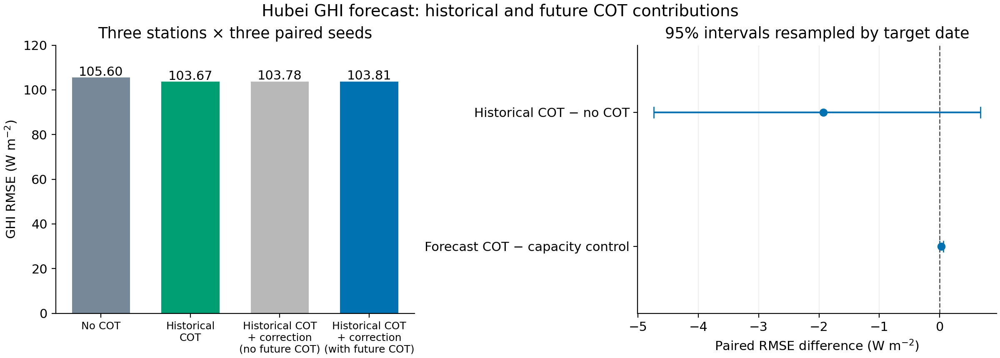

# 历史与未来COT对湖北GHI预报的四组配对结果

## 回答的问题

固定已修正的SimVP、R和3×3站点输入，历史COT能否帮助未来0–4小时GHI？当历史COT已经可用时，未来预测COT是否还能通过一个小型条件修正分支提供增量？

## 结果

湖北牛首、王寨、米庄，三组配对种子42/43/44。三站共15,275条不同站点预报行、22个北京时间目标日期；三seed重复评价不增加独立天气样本数。逐站逐seed先计算RMSE，再等权平均。

|输入方式|RMSE W/m²|MAE W/m²|Bias W/m²|
|---|---:|---:|---:|
|无COT|105.595|70.417|−1.092|
|加入8帧历史反演COT|103.670|68.956|+0.250|
|历史COT＋不读取未来COT的同容量修正头|103.783|69.649|+2.759|
|历史COT＋读取未来预测COT的修正头|103.808|69.698|+2.828|

历史COT相对无COT降低RMSE **1.925 W/m²（1.823%）**。九个站点×seed配对均改善，三站平均相对改善为牛首0.741%、王寨3.099%、米庄1.556%。但5,000次目标日期配对bootstrap的RMSE差95%区间为 **[−4.734,+0.670] W/m²**，尚未证实稳定收益。标签≥800 W/m²时的等站等seed平均偏差由−48.363改善到−45.376 W/m²；这是条件点估计，未单独估计区间。

未来COT修正相对不读取未来COT的同容量修正头，RMSE差为 **+0.026 W/m²**，95%区间 **[−0.003,+0.059]**；相对只加历史COT的基底，RMSE差为 **+0.139 W/m²**，区间 **[−0.490,+1.001]**。这轮没有发现未来COT的额外收益，也不能由极小点差判断稳定退化。

## 这次与旧实验的区别

没有更换或重训上游。新增因素限于历史COT基底之上的条件残差，并保留相同参数数、不读取未来COT的对照。无COT/历史COT两个基底都是47,873参数；两个修正头均9,922参数。所有配对均使用相同初始化、同阶段样本顺序、batch1536、30轮和更新数。

新F/C日期划分只从既有train确定，按月份元数据选取，不看模型误差。基底F_fit各约3.45万–3.59万行；F_select为每月一个训练日。融合C_fit与C_select各覆盖12日，分别约2,590–2,691行和2,602–2,912行；两阶段基底权重完全相同，不在验证前重新全量拟合。基底归一化只用F_fit；未来COT归一化只用C_fit。官方validation不选epoch或门控。原有train-OOF/full上游来源差异仍明示保留，本轮只隔离GHI训练阶段，不能称全链在C从未见过任何监督。

每个基底完成690或720次更新，修正头每个完成60次更新。所有修正头均按C_select选到第1轮；未将第0轮作为训练候选，不能事后改成选第0轮并宣称门控成功。当前结果不支持通过延长该修正训练寻找增益。缺测回退在所有阶段有相同规则，已验证零初始化函数等于基底、强制缺测时精确退回基底、基底训练后未被修正阶段改变。

## 复核、算力与产物

- 成功训练/评分：PBS **215681.tc6000**，浙师大学院服务器node22，A800 GPU **0/1/3/4**，exit_status=0，PBS walltime **107秒**（调度器total_runtime约107.9秒）。1/2/4独立worker实测合计吞吐约41.6万/104.8万/250.0万examples/s，选4卡；这是短批次驻留张量吞吐，不代表原始卫星全流程速度。
- 数据准备PBS215680在全部数组落盘后，末尾写记录时因str/Path类型错误退出。失败日志及代码归档保留；仅修复哈希函数，再对已有文件逐个核验后补写完成记录，没有重造数值，也未把原失败作业改称成功。
- 独立本地程序直接读36份保存预测，核对键、标签、晴空值、30轮/更新预算、配对初始化和行序。第二种聚合实现复现全部RMSE及日期区间，RMSE最大差 **1.42×10⁻¹⁴ W/m²**。
- 完整checkpoint在远端 `/public/home/slfu/ttzhou/swc/irradiance_forecast/SolarCOTIFS_20260907/experiments/hubei_forecast_cot_increment_20261022/training_attempt1/pairs/<Station>_seed<42|43|44>/G<0|1|2|3>_best.pt`；相邻`_last.pt`保存30轮模型、优化器、调度器及更新计数。`evidence_attempt1/CHECKPOINT_SHA256.txt`列实际文件哈希。
- 本地及仓库保存代码、运行配置、全部逐样本验证预测、日志、评分、日期分配元数据、图和独立复算结果。派生训练缓存与模型本体留远端，不复制原始卫星数据至Git。
- 输入仍是历史真实AGRI与未来预测AGRI；未来COT来自预测AGRI→冻结R。没有未来真实AGRI/CPP作为输入。没有新增同期反演或COT预测指标；没有读取test/buffer载荷，没有修改论文。

## 决策与论文含义

历史COT的方向再次一致，但本轮使用的是与此前重合的开发验证日期，不能把两轮结果当作两份独立证据。未来COT修正未超越同容量对照，按方案关闭该融合候选，不增加seed、改阈值、换更大门控或训练更多epoch。不要将本次结果升级为独立测试或把失败唯一归因到SimVP底图。

当前可表达的结论是“历史COT条件下的GHI预报有约1.82%的验证点估计改善，日期不确定性仍允许零收益；未来预测COT的额外收益未获支持”。论文同期COT反演主线继续保留；是否可作独立新时段确认须先冻结候选和核实新时段来源，当前test仍关闭。
