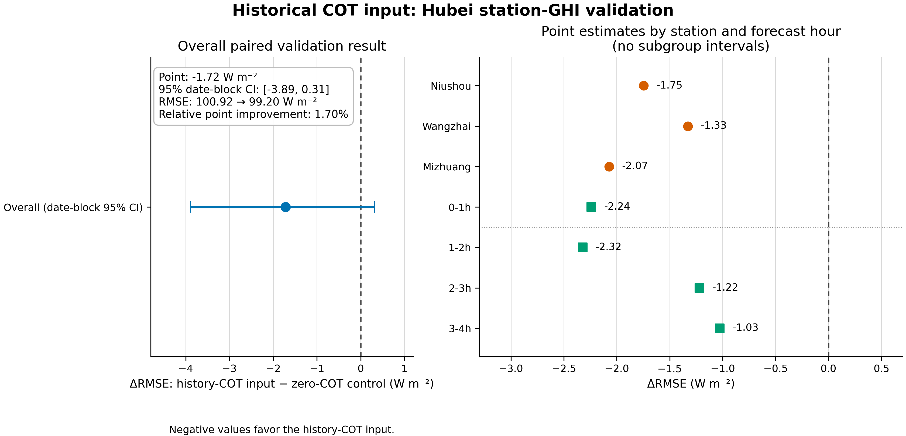

# 历史 COT 输入对湖北站点 GHI 预报的验证结果

## 回答的问题

在同一套湖北未来 AGRI 外推和站点 GHI 预报设置下，把**过去 8 帧真实 AGRI 经冻结 R 反演出的历史 COT 序列**加入 GHI 头，能否改善未来 0–4 小时 GHI？这项实验没有把未来预测 COT 送入 GHI 头，因此不等于“预测未来 COT 提高了 GHI”。

## 配对设置与评价范围

比较两组：对照组保留 COT 支路但输入标准化零值；历史 COT 组输入相同 8 帧历史 AGRI 经冻结修正 R 得到的站点 3×3 COT 序列。两组共享历史 AGRI、未来 16 帧 SimVP 预测 AGRI、太阳几何、标签、样本顺序、初始化和训练预算。每站 3 个配对种子，共 9 对；每个模型均为 batch 1536、30 轮。评价仅使用验证集：15,275 个站点—目标时刻行（牛首 5,305、王寨 4,883、米庄 5,087），覆盖 22 个 BJT 目标日期。独立复核从 18 份已保存的验证预测重新计算 FP64 指标；三站、三种子、两臂的键顺序、标签和晴空因子完全相同，预测文件哈希与主评分记录一致。

## 主要结果

| 验证指标（站点等权、种子等权） | 零 COT 对照 | 加历史 COT | 差值 / 相对变化 |
|---|---:|---:|---:|
| RMSE（W m⁻²） | 100.918 | 99.202 | −1.715；点估计降低 1.70% |
| MAE（W m⁻²） | 68.414 | 67.000 | −1.414 |
| Bias（W m⁻²） | +2.729 | +3.305 | +0.576 |

主要差值定义为 RMSE(历史 COT) − RMSE(零 COT)，负值表示历史 COT 组更低。按 5,000 次 BJT 目标日期配对 bootstrap，RMSE 差值 95% 区间为 **[−3.888, +0.310] W m⁻²**，相对改善区间为 **[−0.315%, +4.086%]**。区间跨零，所以现有验证只能报告 1.70% 的点估计，**尚未证实稳定增益**。

九个站点—种子配对的 RMSE 点估计都较低。按三种子平均：牛首 93.580→91.833（Δ=−1.747 W m⁻²），王寨 97.996→96.668（Δ=−1.328），米庄 111.177→109.106（Δ=−2.071）。四个小时段的站点×种子等权点差也均为负：0–1 h −2.241、1–2 h −2.322、2–3 h −1.220、3–4 h −1.027 W m⁻²。分站与分时段区间没有单独估计，不能把这些点差解释为统计显著。

## 结果含义与边界

这组验证结果说明：在当前模型和样本上，历史 COT 序列可能包含有助于未来 GHI 的信息；结果方向在三站、九个种子配对及四个小时段一致，但日期块不确定性仍允许零收益或轻微退化。因为 COT 是由同一批历史 AGRI 派生出来的，它不是独立观测。

本结果**不能证明未来预测 COT 对 GHI 有增益**，也不能替代 attempt12 的预测未来 COT 配对结果（95.703→95.609 W m⁻²、日期区间跨零）。历史 COT 输入和未来预测 COT 输入是不同的信息来源与实验合同；不能将 1.70% 当作预测 COT 的效果，也不能据此认定底图外推是唯一瓶颈。所有数字均为验证结果，不是独立测试。

## 多卡运行与复现材料

PBS `215507.tc6000` 在浙师大学院服务器 `zjnu-hpc` 的 node22 使用 4 张 A800（物理 GPU 0、3、4、5），正常完成，作业时长约 13 分 47 秒。profile 总吞吐为 1 worker 651,737、2 workers 704,951、4 workers 938,328 examples/s；四 worker 比双 worker高约 33.1%，比单 worker高约 44.0%。这属于小 GHI 头独立配对任务的实测 profile，不代表单模型本身加速；4 卡并行独立站点—种子任务，没有改变单模型 batch、轮数、数据顺序或更新合同。

- 主评分：`results_attempt2/scored_attempt2/score_receipt.json`
- 独立 FP64 复算：`results_attempt2/scored_attempt2/independent_audit.json`
- 逐站/种子：`results_attempt2/scored_attempt2/arm_metrics.csv`
- 分时效/小时：`results_attempt2/scored_attempt2/by_lead.csv`、`by_hour.csv`
- 多卡 profile：`results_attempt2/throughput_profile.json`
- 独立复算程序：`audit_saved_history_cot_predictions.py`
- 绘图程序与输出：`plot_history_cot_ghi_validation_attempt2.py`、`results_attempt2/history_cot_ghi_validation_attempt2.png/.pdf`

所有运行和独立复算均为 train/validation only；test 与 buffer 读取数均为 0。没有启动额外种子搜索：现有主要日期区间跨零，且增加随机种子不能增加独立目标日期。若要继续检验历史 COT 的泛化，需要先确定新的、未用于本轮选模的验证日期合同；在此之前不把验证结果升级为正式论文主结论。

## 补充：原标签与checkpoint实际文件绑定复核

另一次本地独立复算已将18份保存预测的真值和晴空量逐键绑定至原GHI_pack_attempt12数值数组（按训练实际float32转换），并核对源数组哈希、18份预测及36个best/last checkpoint实际哈希。九对模型初始化、样本次序和更新数相同，30轮/batch1536设置一致。使用日期频数权重的独立bootstrap实现重现主区间，差异<1e-10；没有重选checkpoint。结果为`receipts_heartbeat_20261022T0117/independent_saved_prediction_check.json`，脚本为`verify_saved_history_predictions_20261022.py`。原始标签、权重和逐样本副本仅用于本地复核，不随报告推送。
