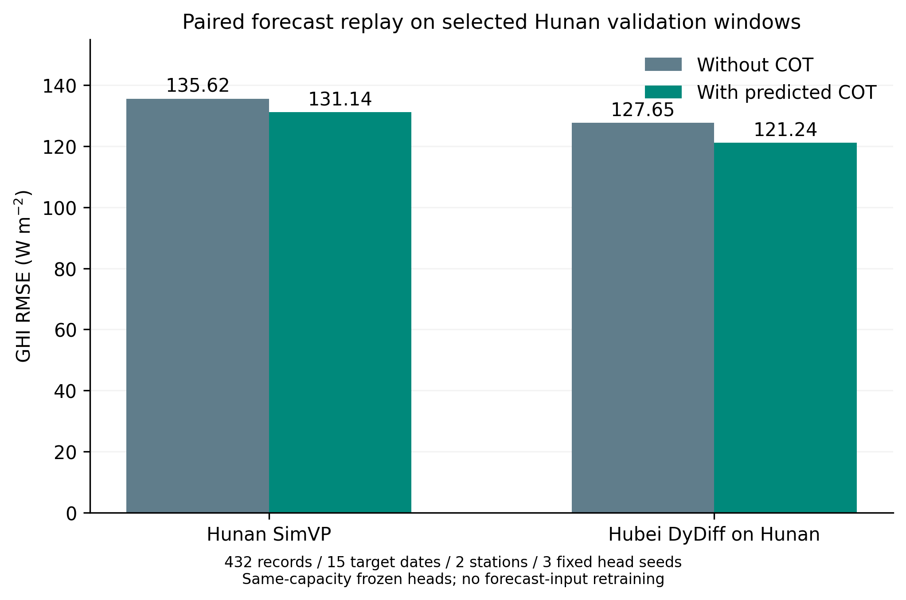
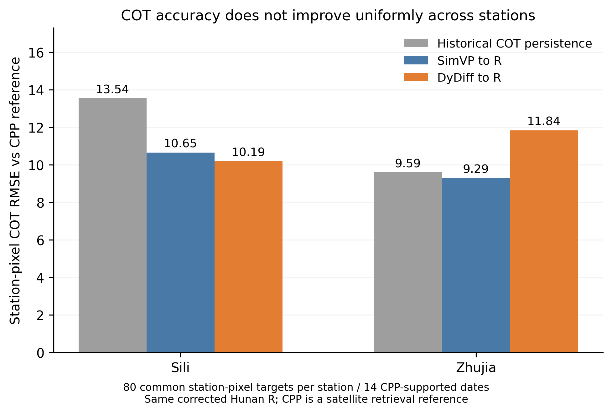
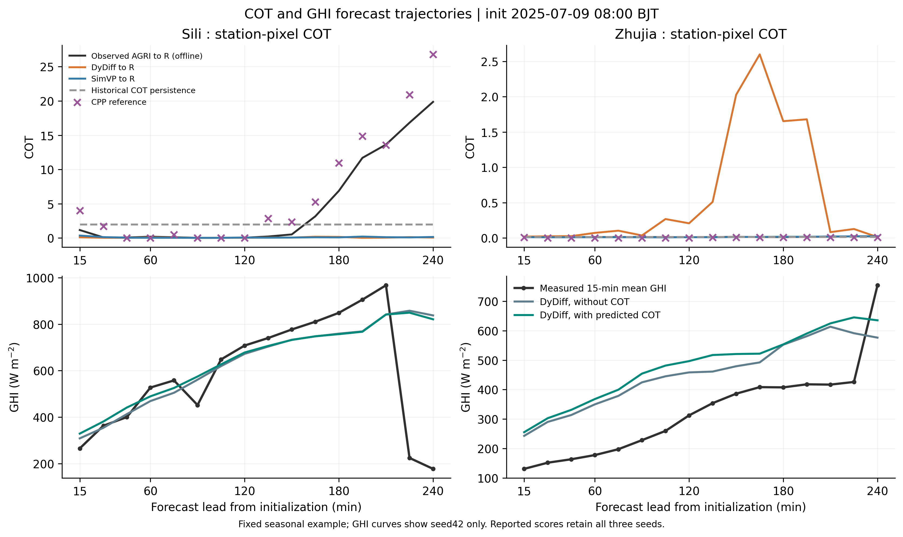

# 湖南跨区域DyDiff预报：加预测COT改善GHI，但未整体改善COT误差

本轮回答：已有湖北DyDiff直接应用湖南时，预测COT是否能给站点GHI预报提供增量？**在预先固定的小样本验证回放中有正向增量：127.647→121.243 W/m²，下降5.017%；但不能据此称全年或独立测试收益，也不能将其解释为DyDiff的COT精度已超过SimVP。**

所有结果由保存逐样本输出独立FP64复算。湖南独立DyDiff八卡训练216594继续运行；本诊断为CPU作业216596，node7/16CPU，65.5秒完成，没有增加第9张GPU，也没有重训R或GHI头。

## 1. GHI：同一DyDiff预报图下加预测COT的增量

两站×三个种子。每组先算自己的RMSE，再对站点和种子等权平均，未把三种子预测平均当主成绩。

| 范围 | 不加COT RMSE（W/m²） | 加预测COT RMSE（W/m²） | RMSE降幅 |
|---|---:|---:|---:|
| 四里，三种子均值 | 134.026 | 126.375 | 5.709% |
| 竺家，三种子均值 | 121.268 | 116.111 | 4.253% |
| 两站、三种子等权 | **127.647** | **121.243** | **5.017%** |

总体差AC−A为−6.404 W/m²；5000次目标北京时间日期块配对bootstrap的描述性95%区间为[−11.755,−0.447] W/m²。六个站点/种子配对均改善；三种子的等站RMSE分别为126.750→120.675、128.104→121.214、128.087→121.840 W/m²。

15个有GHI标签的日期中，11日改善、4日退化。逐一去掉任一日期后的总体RMSE差仍为−8.427至−4.638 W/m²，说明本批点估计不完全依赖某一个日期；这项事后影响诊断没有用于筛样或训练。日期少、每日期仅一个窗口，不能据此认为全年稳定提升。

### 同键SimVP对照

| 底图输入 | 不加COT | 加预测COT | COT增量 |
|---|---:|---:|---:|
| 湖南月度SimVP预报图 | 135.616 | 131.139 | 下降3.301% |
| 湖北DyDiff直接预测湖南 | 127.647 | 121.243 | 下降5.017% |

单位均为W/m²。SimVP加COT的差为−4.477，日期块区间[−8.811,+0.133]跨零。相同加COT头下，DyDiff比SimVP的点估计低9.896 W/m²，但区间[−25.151,+6.422]跨零；不能据此称DyDiff已普遍优于SimVP。两者本身的训练区域、目标、归一化及几何合同不同，属于现成资产对照，非纯架构消融。

## 2. COT：独立CPP支持上没有整体超越SimVP

主COT评价只取站点像元，不对输入云图做全图均值、p90或空间平均。共同CPP支持有160个站点/时效记录，两站各80个、覆盖14个日期。表中是每站RMSE及其等权均值；CPP是卫星检索参考，不是独立地面真值。

| COT来源 | 四里RMSE | 竺家RMSE | 两站等权RMSE |
|---|---:|---:|---:|
| 历史COT保持不变 | 13.541 | 9.593 | 11.567 |
| SimVP预测AGRI→修正R | 10.654 | 9.291 | **9.973** |
| DyDiff预测AGRI→同一修正R | **10.189** | 11.838 | **11.014** |
| 真实未来AGRI→同一R，仅离线参照 | 9.979 | 8.565 | 9.272 |

DyDiff相对SimVP的总体RMSE点估计高1.041（高10.438%），日期块差区间[−0.332,+2.972]跨零；四里略好，竺家较差。相对历史COT持平，点估计低0.553（下降4.782%），区间[−2.673,+1.273]跨零。**因此这轮不能写“更换DyDiff使COT精度总体更高”。**

全16窗口用同一R(真实未来AGRI)作为响应代理时，共510个有效站点像元记录，DyDiff/SimVP/持平的等站RMSE为6.292/5.371/6.209。该全覆盖代理不是COT真值。

进一步限制到GHI实际共同键后，CPP支持有四里64、竺家76个记录，等站COT RMSE为DyDiff11.016、SimVP9.957、历史持平11.533，方向不变。故上述GHI正增量不能简单归因于所评COT的普通RMSE更低，也不是仅因COT/GHI覆盖范围不同而造成表面矛盾。

## 3. 固定加COT头的替换诊断

保持同一DyDiff预报AGRI、几何和同一个加COT头，只替换未来COT来源：

| 未来COT来源 | GHI RMSE（W/m²） | 用途 |
|---|---:|---|
| DyDiff预测图→R | **121.243** | 本轮实际预测COT链路 |
| 初始化时真实历史COT保持不变 | 132.061 | 因果持平对照，点估计较差 |
| 真实未来图→R | 111.471 | 不可部署oracle，仅归因 |

历史持平替换带来+10.818 W/m²，区间[−1.655,+21.316]跨零。真实未来图反演COT替换则带来−9.772 W/m²，区间[−20.429,−0.883]。在这些窗口中，固定头能够利用更接近实况的未来COT表示；但oracle不能作为预报收益，更不能证明所有剩余误差都来自底图。R的反演偏差、头部训练分布和标签质量也未被完全隔离。

同一批同期真实三帧输入的无/有COT回放为99.574→96.155 W/m²（下降3.433%），其区间跨零；它与上表真实预测输入分开，不拼成一项预报结果。

## 4. 实际轨迹说明正增量不代表每次天气都改善

该例固定为预先画过的2025-07-09 08:00 BJT初始化，图中GHI只展示seed42，主指标保留全部种子。四里末段真实图→R与CPP都显示增厚，而DyDiff和SimVP的COT都未恢复这一变化；两组GHI也都漏掉+225分钟附近的明显下降。竺家该日加COT的曲线还可局部变差。7月9日也是本批总体加COT退化的日期之一，保留此负例，不以好看的案例替代总体配对评分。

另一预先指定的冬季例见[1月5日轨迹](attempt1/figures/cot_ghi_trajectory_01146.png)；四里无对应冻结GHI标签，图中明确留空，不补标签或挑其他日期取代。

## 5. 数据、模型和复核范围

- 输入是已预先固定的16个跨季节湖南val窗口，每个8历史→16未来、15分钟；与湖北训练日期冲突的24帧窗口预先排除。不是观察到GHI收益后挑出来的窗口。
- COT共512条站点/时效记录，R响应代理有效510条，正确CPP站点支持160条。GHI共432条（四里192、竺家240），15个目标日期。64条缺现有有效标签、16条按用户既有规则排除四里2024-09-05；其他可疑零值保留。完整缺行原因见excluded_ghi_rows.json。
- 使用已经重训的修正几何R（checkpoint7273a21…）和同容量三帧17槽GHI头（M00/M10），两个头均不读判云通道。R保留16×16上下文，GHI只取中心3×3，全部帧及空间位置保留。COT是同源AGRI经CPP监督R得到的派生表示，不是额外独立观测。
- R/GHI按其训练时修正太阳几何使用；SimVP仍按其训练时旧几何推理，再把预测图送入同一修正R。没有把新几何临时强塞给旧SimVP，也没有让新权重接续旧权重。
- 三帧严格为target−30/−15/target。+15分钟的输入为init−15、init、预测+15；+30分钟为init、预测+15、预测+30；后续均为预测帧。真实未来AGRI/CPP只用于离线评分或单列oracle。未来QA没有成为模型特征；缺测只在评价中对齐。
- GHI标签是以target结束的15分钟均值，输出乘同一区间晴空GHI。实际输入重建与原保存验证预测最大差：无COT0.000245、有COT0.064606 W/m²；仅重载权重比较最大差0.000245 W/m²。CPU/GPU与R批次差异已保留，不能宣称逐位一致；该量级远小于6.404的主差值。
- **GHI头原训练为同期真实三帧输入，本轮没有进行DyDiff适配重训**。权重在已有验证集上选模，这15日期也是验证复用。所有区间只是小样本条件分析，未做多重比较校正，不能直接作为独立测试或论文总体收益。

## 6. 可复现产物和下一步

服务器原始产物：`/public/home/slfu/ttzhou/swc/irradiance_forecast/HunanDyDiff_20261028/cot_ghi_diagnostic/attempt1/`。本地同名目录已回收逐样本COT/GHI预测、键、CPP掩膜、来源和复核结果；大数组不进Git，来源SHA与交付哈希保留。

执行evaluate_cpu.py；独立评分score_saved.py；真实输入重建recheck_observed.py；绘图plot_results.py。权重及归一化不覆盖原文件，全部已冻结。无test载荷、无新模型训练、未修改论文正文。

下一步应扩大到全部湖南冻结验证窗口并保持相同预报输入与评价规则，检验本次约5%的增益能否保持，再决定是否作为论文预报应用证据。不能只保留这16窗口或只挑有收益的天气。现阶段无需为得到正收益继续扫描阈值或更换GHI结构。
