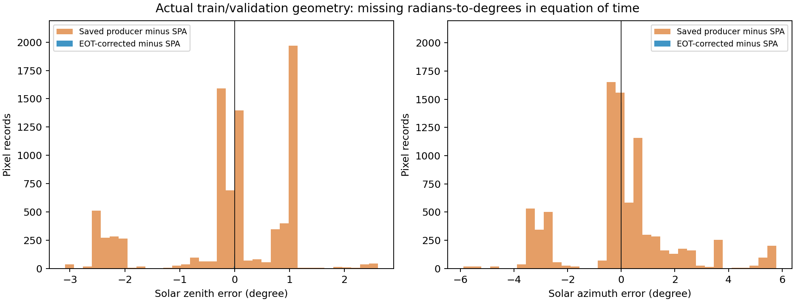
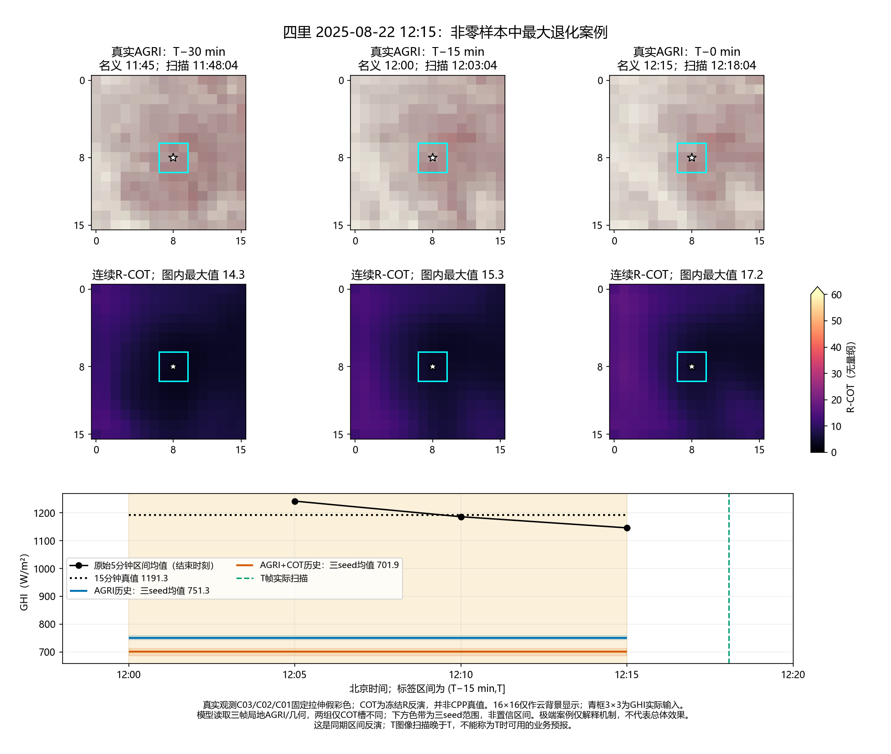

# 连续COT历史配对实验：源零值、太阳几何与下游价值

**结论：已定位并修正太阳几何中的真实单位错误；本轮三帧连续COT的平均RMSE增益仅0.24%，日期区间跨零，未形成稳定增益。** 白天持续零值对四里误差有很强牵引，但排除该组的评分敏感性仍未证明稳定COT收益。

## 1. 白天持续零值核查

- 仅使用新月度train/val的111,466条标签记录，去重原5分钟值；无同时间冲突。固定标记规则：至少6条相邻5分钟源记录恰为0，目标标签三条均落在该连续段，且该区间晴空GHI>200 W/m²。该标记表示可疑，不等于已确认故障。
- 全原GHI pack中标记：四里train318、val34；竺家train462、val16。另一个已完成的源XML审计在更广白天零值范围确认四里1,731、竺家2,092个值为源表显式文本0；不是空值填零或Excel公式生成。两种规则的计数不可混用。
- 本轮重新读取四里5个允许日期706个日间单元格、竺家4个日期672个日间单元格：与缓存逐值一致、均为0、无缺测单元格。源表只有站名、日期等元信息；四里OBJ_TYPE=IRRADIANCE，无传感器质量/停机标记，无法判定零值的上游业务语义。
- 本轮原标签、训练样本的零值均保留。正式验证的50条可疑记录中四里34条、竺家16条；四里34条占三seed无COT平方误差的51.96%，竺家对应为3.85%。这是误差记账，不能据此宣布传感器故障。

## 2. 太阳几何：发现可复现的单位错误

取回原预处理代码`source_snapshot/preprocess_hunan_256.py`，在28个事件窗口加143个月份/时段分层窗口、共8,455个像元上复现缓存。原公式与缓存最大差0.000061°。

均时差的三角展开结果是弧度，原代码写成`4 * expression`，应为`4 * rad2deg(expression)`，缺少180/π因子。例如约15分钟的季节性修正被压缩至约0.26分钟。这与实际扫描晚于名义时间约3分钟是两个不同因素。

| 对独立NREL SPA的名义UTC参考 | 原太阳角最大绝对差 | 修正后最大绝对差 |
|---|---:|---:|
| 天顶角 | 3.0897° | 0.0101° |
| 方位角 | 5.8915° | 0.0215° |

修正只进入本轮新GHI头的两组共同几何。旧缓存、SimVP和R的训练输入、冻结权重与已有COT bank不覆盖、不暗改。**本轮不是修正太阳几何后重新训练R的实验，也没有单独隔离几何修正带来的GHI收益。** 原SOA在物理夜间置零的既有合同会放大全时期cosRAA最大差；不能将那一最大差全归于均时差错误。

## 3. 配对合同

- 同一期新月度划分，原15分钟窗口(T−15,T]标签；两站独立。三帧名义T−30/T−15/T使实际扫描覆盖整个区间。T图像实际晚于T，本轮是离线同期区间反演，不能称预报或T时业务可用。
- 共同样本：train 47,666，val 4,263，52个目标北京时间日期。验证覆盖原队列4,479条的95.18%；其余因缺同split、同日历史而两组共同排除，不因误差或天气选择。
- A_history读取相同的三帧13通道AGRI与修正名义UTC cosSOZ/cosRAA；AC_history另加入对应三帧连续log1p(R-COT)。局地原分辨率3×3，保留时空排列，无GAP/空间平均/p90；两组COT输入槽分别置零/填值。R由16×16上下文反演，其3×3输出也可能携带大于GHI原始小邻域的上下文，不能将增量直接称为纯物理或独立观测贡献。
- 相同模型41,665参数，相同共同权重及初始输出、标准化、样本顺序、30轮预算；seed42/43/44全部完成。四里390更新/臂，竺家420更新/臂。相同参数总量不等于完全控制有效容量。
- train-only拟合AGRI/COT标准化；同val每轮选checkpoint。实际前后向梯度见证、初始函数完全一致检查与12权重CPU重载通过；最大逐样本CPU/GPU差0.000428 W/m²。
- 复用已有扫描元数据：51,911/51,929条完整；18条训练样本缺时间记录，验证4,263条全部有实际三帧时间并覆盖标签区间。18条训练图像保留，按名义时间使用，未假称其实际扫描已核验。

## 4. 独立FP64结果

下表为各站三个seed RMSE的算术均值；总行再对两站等权。Δ=AC−A，负值有利COT，单位W/m²。

| 范围 | A历史 | AGRI+COT历史 | ΔRMSE | 日期簇95%区间 |
|---|---:|---:|---:|---:|
| 四里 | 124.222 | 123.901 | -0.322 | [-2.286, +1.003] |
| 竺家 | 92.425 | 92.230 | -0.195 | [-3.537, +3.187] |
| 两站等权 | 108.323 | 108.065 | -0.258 | [-2.149, +1.571] |
| 仅评分排除可疑零值（4,213条） | 88.888 | 88.383 | -0.505 | [-2.357, +1.439] |

- 三seed两站等权Δ分别为+0.547、-0.458、-0.864；样本标准差0.727。2/3改善，seed42退化，不宣布稳定增益。
- 同一估计口径的平均MAE：66.513→64.424 W/m²。作为次指标保留，不替代预定RMSE主结论。
- 2000次目标BJT日期簇配对bootstrap，同时保持站点、方法和seed配对。区间条件于已经查看的验证选模；不是独立test区间。第二实现直接逐行加日期权重，重现主RMSE和区间至1e−8。
- 高变化组（15分钟内三条原5分钟值极差>100，673条）点估计ΔRMSE −1.313 W/m²，区间[−4.818,+1.970]；仅作机制分层，未证明在快速变化天气中稳定改善。

## 5. COT历史是否真的被使用

固定训练好的AC头，把过去两帧COT替换成当前COT重复，AGRI与几何不动；这是同一头的输入扰动，不是重训过的静态COT基线。
- 四里：重复当前COT使三seed平均RMSE增加0.124 W/m²；GHI平均绝对变化5.58 W/m²，说明历史槽确实影响输出。两组头总体GHI平均绝对调整为17.04 W/m²；当A低估时向上调整比例49.0%，A高估时向下调整比例68.6%。这些分组只作事后诊断，观测没有进入推理。
- 竺家：重复当前COT使三seed平均RMSE增加0.828 W/m²；GHI平均绝对变化8.09 W/m²，说明历史槽确实影响输出。两组头总体GHI平均绝对调整为18.54 W/m²；当A低估时向上调整比例48.8%，A高估时向下调整比例67.2%。这些分组只作事后诊断，观测没有进入推理。

因此，收益小不能简单解释成“历史COT完全没用到”。模型有实质输出变化，但改善与恶化相抵，特别是A低估时，加入COT并未可靠地把结果向上拉。它与AGRI历史的信息重叠、R误差、空间/时间支持和观测质量均可能有关；本轮没有把这些原因逐一因果隔离。

## 6. 真实连续云图

按两站各自非零GHI且晴空GHI>200的共同验证记录，选三seed平均Δ平方误差最大改善/最大退化各一例；共4例，仅描述机制。每例三帧真实AGRI固定假彩色、连续冻结R-COT、实际扫描时间、三条原5分钟GHI以及配对15分钟输出同屏。显示16×16背景，青框3×3才进入GHI。原图中心3×3与实际模型输入逐元素核对通过。

[四例连续云图PDF](actual_AGRI_COT_history_and_GHI.pdf)

该例原始三条GHI为1242/1186/1146，区间均值1191.3；无COT三seed平均751.3，加入COT进一步降至701.9。历史已进入模型，但这个原先低估的事件仍向错误方向调整；图像本身不足以区分云边增强、代表性偏差或源观测误差。

## 7. 对论文与后续的判断

1. 硬清零路线继续封存；修正后的连续历史候选仍未提供稳定的RMSE增量证据，不继续在这批验证上调网络或挑种子。
2. 太阳几何单位错误应作为数据/工程修复记录，不能包装成论文创新；既有R/S来源仍包含旧几何，本轮不宣称整条链已修复。若后续重建R/S，应另名、用正确几何随机初始化并独立验证。
3. 四里极少量白天持续零值对评价有巨大牵引，应优先取得传感器状态或可核验的观测来源。当前可以报告带标记的敏感性，不能宣布这些记录无效，也不能把排除后数值当正式主表。
4. 本轮只支持“当前三帧小邻域设计尚无稳定COT额外收益”；不否定其他同期反演配置，不推出业务预报增益。任何主表/独立test需要模型和数据合同冻结后另行完成。

## 8. 工程与复现

- 服务器：`/public/home/slfu/ttzhou/swc/irradiance_forecast/SolarCOTIFS_20260907/experiments/cot_interval_history_20261015_v1/`。data_attempt1为未训练两帧准备，data_attempt2为正式三帧；results_attempt1为12臂正式配对输出。
- PBS214194.tc6000，node22单A800 80GB，profile batch1792，峰值分配0.367 GiB、reserved0.748 GiB；12臂实际拟合约19.28秒，不含数据准备/profile。小头数据已预载；GPU全程只用一张。Luna记录完成状态C；随后调度器已清除历史，未保留可重读的最终PBS exit_status，不凭Unknown Job Id推断失败。
- 源工作簿核查在FD-201完成；不更改源文件。源码、原producer快照、修正公式、数据准备、提交、训练、独立分析和绘图位于`refine-logs/cot_interval_history_20261015/`。
- `independent_score.json`、`secondary_recompute.json`、`seed_metrics.csv`、`paired_validation_scoring.npz`支持无训练复算。运行`python refine-logs/cot_interval_history_20261015/rescore_saved_pair.py`可重新验证主值和日期区间。
- 权重及完整输入在服务器保存，checkpoint/输入文件哈希见`results_attempt1/completion.json`与`profile_and_setup.json`。未读取test，不修改论文正文；所有负结果和来源限制保留。
