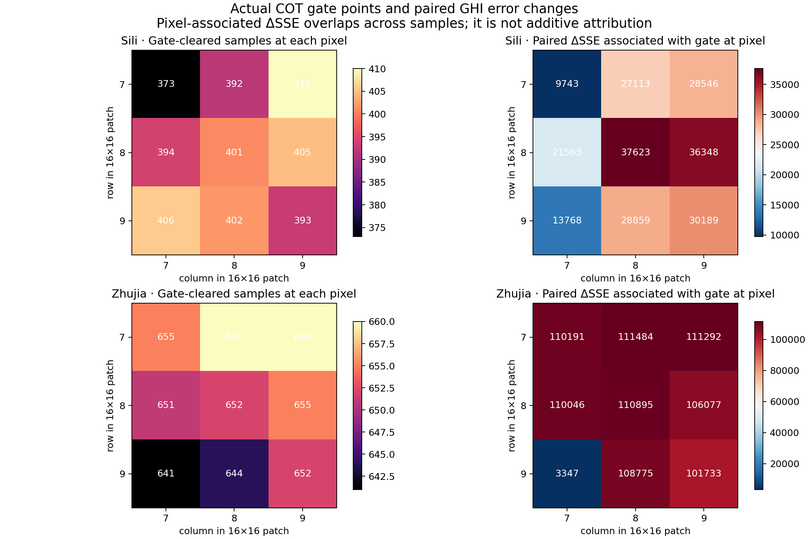

# GHI degradation mapped to actual COT gate points

This is a validation-only analysis of the saved paired seed42 outputs. It uses no test payload.
The station GHI head reads only rows/columns 7–9 of the 16×16 COT patch (center 3×3).

## Grouped paired result

ΔRMSE is gate minus raw, in W/m². ΔSSE is the sum of per-sample squared-error changes.

| Station | Comparison | Gate in center 3×3 | N | Worse fraction | ΔRMSE | ΔSSE |
|---|---|---:|---:|---:|---:|---:|
| sili | separately_trained_raw_vs_gate_heads | any_gate_in_GHI_3x3 | 462 | 0.558 | +0.204 | +38174.3 |
| sili | separately_trained_raw_vs_gate_heads | gate_only_outside_GHI_3x3 | 211 | 0.479 | -0.077 | -4891.1 |
| sili | separately_trained_raw_vs_gate_heads | no_gate_anywhere | 1455 | 0.508 | +0.035 | +9942.8 |
| sili | fixed_gate_head_gate_input_vs_raw_input | any_gate_in_GHI_3x3 | 462 | 0.364 | +0.271 | +50816.8 |
| sili | fixed_gate_head_gate_input_vs_raw_input | gate_only_outside_GHI_3x3 | 211 | 0.000 | +0.000 | +0.0 |
| sili | fixed_gate_head_gate_input_vs_raw_input | no_gate_anywhere | 1455 | 0.000 | +0.000 | +0.0 |
| zhujia | separately_trained_raw_vs_gate_heads | any_gate_in_GHI_3x3 | 709 | 0.309 | +0.603 | +113408.3 |
| zhujia | separately_trained_raw_vs_gate_heads | gate_only_outside_GHI_3x3 | 347 | 0.450 | -0.259 | -23701.7 |
| zhujia | separately_trained_raw_vs_gate_heads | no_gate_anywhere | 1295 | 0.612 | +0.969 | +199377.2 |
| zhujia | fixed_gate_head_gate_input_vs_raw_input | any_gate_in_GHI_3x3 | 709 | 0.412 | +0.929 | +174641.9 |
| zhujia | fixed_gate_head_gate_input_vs_raw_input | gate_only_outside_GHI_3x3 | 347 | 0.000 | +0.000 | +0.0 |
| zhujia | fixed_gate_head_gate_input_vs_raw_input | no_gate_anywhere | 1295 | 0.000 | +0.000 | +0.0 |

CPP confirms gate-cleared cloudy pixels in the center 3×3 for only 13 Sili samples and 17 Zhujia samples. Those are subsets of the gated-center group; missing CPP is unknown, not clear.
The fixed-head comparison changes only the COT input and therefore isolates the input intervention for this frozen head. The separately retrained-head comparison also contains training/normalization differences.

## Point map

The per-pixel ΔSSE map includes every sample where that pixel was cleared. A sample can contribute to several pixels, so these cells overlap and must not be summed as causal contributions. See `center3x3_gate_pixel_association.csv` for the exact counts.

## Representative deterioration cases

- Sili, 2025-07-08 14:45 BJT: observation 462.0, raw head 680.4, gate head 716.5 W/m²; Δsquared error +17,071. The center gate cleared (8,8), (8,9), (9,8), (9,9), with no CPP-confirmed cloudy pixel among them.
- Zhujia, 2024-09-04 14:00 BJT: observation 433.3, raw head 617.8, gate head 813.8 W/m²; Δsquared error +110,721. Eight center pixels were cleared; CPP marked all available cleared locations clear.
- The largest individual regression with an actual CPP-confirmed cloudy center pixel was Sili 2025-07-08 14:30: the point (7,9) had R COT 2.66 versus CPP COT 6.99; observed/raw/gate GHI were 527.7/754.3/779.7 W/m².

## Interpretation boundary

Gate-induced input changes are associated with some GHI error increases, especially where the gate changes pixels read by the head. However, most CPP-confirmed false-clear samples are not the dominant source of the aggregate regression. Separate retraining also changes outputs on samples whose COT was not gated. This analysis identifies where to inspect; it does not establish a physical cause.
